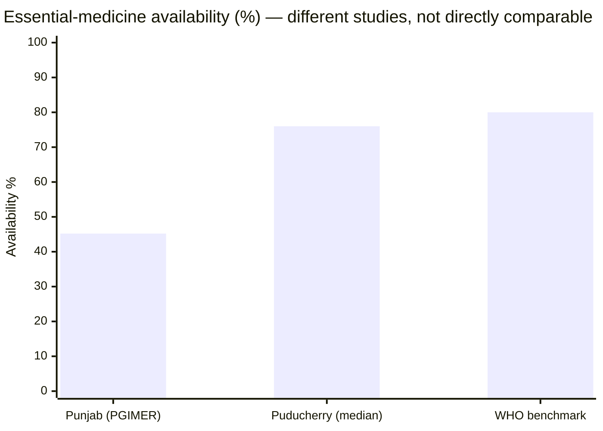
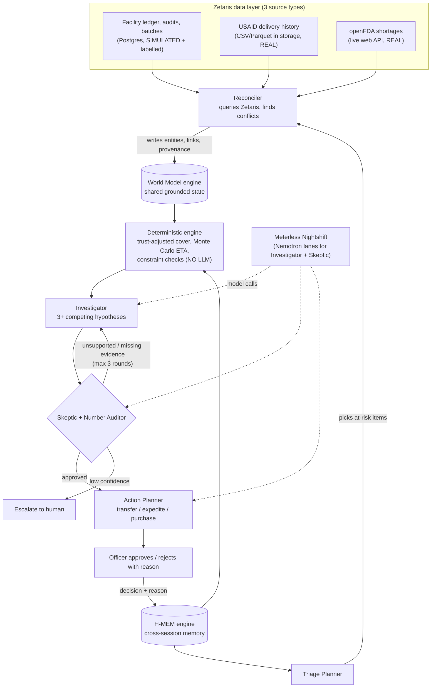
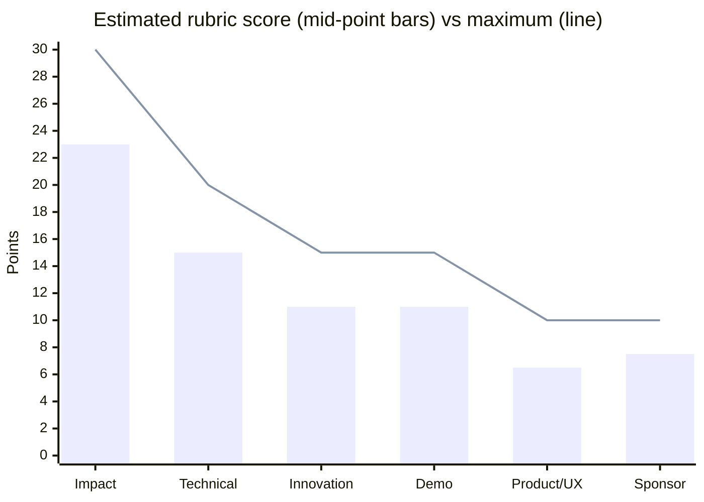
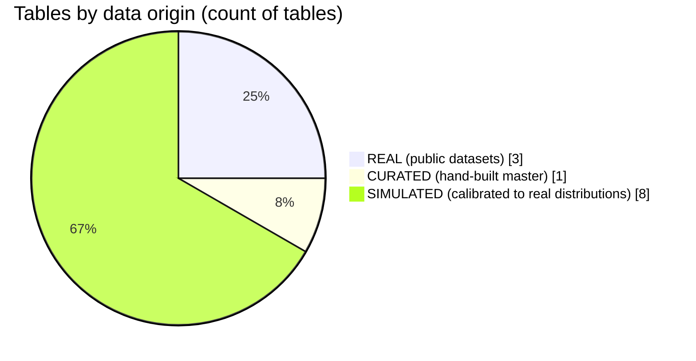

# MedTrace — Research, Impact Case & Execution Plan

**Open Agent Hackathon 2026 · Working document · Written 24 Oct 2026**
**Submission deadline: Tue 27 Oct 2026, 23:45 UTC (= 05:15 IST, 28 Oct)** — plan to submit by ~12:00 UTC on the 27th.

> Scope of this file: research, solution definition, impact measurement, scoring, **data collection (step by step)**, and technical next steps.
> **Out of scope here (you will handle it):** slide deck and demo video.

---

## 0. How to read this document

Every claim carries a label so you always know how far to trust it.

| Label | Meaning |
|---|---|
| 🟦 **SOURCED** | Taken from a public source. Source ID in brackets, e.g. `[S1]`, listed in section 12. |
| 🟨 **ESTIMATE** | My judgement. Not measured. Treat as a planning aid, not a fact. |
| 🟩 **TARGET** | A threshold we set for ourselves. We must **measure** it in our own backtest before we may claim it. |
| ⬜ **PLAN** | A step we intend to do. |
| 🟥 **UNVERIFIED** | I could not confirm this from here. Check it before relying on it. |

Hackathon rule sources are tagged `[H1]`–`[H5]` (your uploaded files).

---

## 1. Executive summary

**What we are building (working name: MedTrace).**
An agent system that helps a **District Drug Warehouse Officer** prevent essential-medicine stockouts by:

1. **Auditing the numbers first** — reconciling stock, order and delivery records that disagree.
2. **Correcting availability** for phantom stock, quarantined stock, near-expiry stock and unreliable delivery promises.
3. **Investigating why** a shortage is forming, using competing hypotheses challenged by a Skeptic agent.
4. **Recommending an action** (transfer / expedite / emergency purchase) with every number traceable to a source row.
5. **Learning** from the officer's approvals and rejections across sessions.

**One-line pitch:**
> *The LMIS tells you what the ledger says. MedTrace tells you whether to believe it, why a shortage is forming, and what to do about it.*

**Why this and not "another stock dashboard":** alert layers on ledger numbers already exist (section 3). The unsolved part is that the ledger numbers themselves are unreliable. That is where we sit.

**Hackathon fit** `[H1][H5]`: Track 2 *The Agent That Can Explain Why* (primary), using Track 1 style reconciliation as the engine. Your 3 use cases map as follows:

| Use case | Where it lives in MedTrace |
|---|---|
| Supply chain prediction | Deterministic engine: trust-adjusted cover, probabilistic ETA, P(stockout before delivery) |
| Procurement intelligence | Action Planner: ranks transfer / expedite / purchase with constraint checks |
| Hypothesis generation & knowledge graph | World Model graph + Investigator/Skeptic loop |

> ⚠️ I could not see the HackOS use-case page. Confirm which track those 3 use cases sit under (checkbox in section 10).

---

## 2. The real problem — numbers

### 2.1 Evidence (all 🟦 SOURCED)

| Finding | Number | Source |
|---|---|---|
| Overall essential-medicine availability, public facilities, Punjab (PGIMER study) | **45.2%** vs WHO benchmark **80%** | `[S1]` |
| Availability gap to benchmark | **34.8 percentage points** (we compute: 80 − 45.2); availability is **56.5%** of benchmark (45.2 ÷ 80) | derived from `[S1]` |
| Sub-centres reporting metformin stockout | **35.2%** (37 of 105) | `[S2]` |
| Sub-centres reporting amlodipine stockout | **44.8%** (47 of 105) | `[S2]` |
| Median duration of those stockouts | **1 to 7 months** | `[S2]` |
| Average out-of-stock days, Punjab: analgesics / endocrine / anti-asthmatic / anti-helminthic | **231 / 211 / 193 / 186 days** | `[S1]` |
| Thrombolytics, anti-cancer, endocrine availability | **under 30%** | `[S1]` |
| People in India with limited or no access to essential medicines (WHO figure quoted in a 2015 study) | **~68%** | `[S3]` |
| Puducherry, 50 key medicines, 10 facilities: median availability | **76%** (range 66–80%) | `[S4]` |
| Stockouts at community facilities lasting weeks (as cited by an MIT Solve entry) | **4–14 weeks** | `[S5]` (secondhand) |
| Cause identified in a rural Indian supply-chain study: uncertain lead time and demand | qualitative | `[S6]` |
| Stock visibility across the chain described as fragmented and inaccurate | qualitative | `[S5]` |



**Caveats (read these):**
- Studies use different facility mixes, years and methods. The chart shows scale, not a ranking.
- These numbers prove the *problem*. They do **not** prove our *solution*. Our proof comes from our own backtest (section 6).

### 2.2 Why the existing numbers are unreliable (the gap we target)

| Failure mode | What the ledger says | What is true | Evidence status |
|---|---|---|---|
| Phantom / ghost stock | 120 units | ~70 units after a physical count | 🟨 Pattern consistent with `[S5]` visibility problem; no public quantification found |
| Delivery promise slips | "Arrives day 6" | Arrives day 9 | 🟦 Real slippage data exists in `[S7]` (we will measure it) |
| Quarantined / expiring batches counted as usable | counted | not usable | 🟨 |
| Unit-of-measure mismatch (strip vs tablet) | inflated | corrected | 🟨 |
| Surplus at a peer facility is not transferable | "surplus" | near-expiry or locked | 🟨 |

---

## 3. Market and landscape

### 3.1 What exists

| Player / approach | What it does (per public descriptions) | Source |
|---|---|---|
| **e-Aushadhi** (public drug LMIS, multiple states) | Drug supply chain system with stock-level and expiry alerts, state dashboard, supplier and quality-lab integration | `[S8]` |
| **Andhra Pradesh e-Aushadhi upgrade** | Public stock dashboards, QR availability checks, expiry alerts (under 6 months shelf life) | `[S9]` |
| **PRAVAAH** (MIT Solve entry, Madhya Pradesh) | Predictive analytics plus barcode-enabled visibility, integrated with e-Aushadhi, antibiotics focus. A proposal; deployment status 🟥 UNVERIFIED | `[S5]` |
| **Retail pharmacy AI agents** (e.g. "Aushadhi Vault", a hackathon entry) | Prescription scanning, billing, low-stock and expiry flagging, reorder suggestions for a single pharmacy | `[S10]` |

### 3.2 Positioning

We do **not** replace e-Aushadhi. We sit on top of its exports as an **audit-and-investigate layer**. PRAVAAH validates the problem and shows we are not alone nearby, so we should not claim "nobody is working on this."

### 3.3 Capability coverage — 🟨 ESTIMATE (positioning aid, not proof)

> I wrote this checklist, so it naturally favours us. The comparison columns are judged only from public descriptions; their internal features may be broader. Use it to see *where we differ*, not as a market-share claim.

Scoring: ✅ = 1, 🟡 = 0.5, ❌ = 0.

| # | Capability | Ledger-alert layer (e-Aushadhi-style) | Retail pharmacy AI agent | **MedTrace (planned)** |
|---|---|:-:|:-:|:-:|
| 1 | Stock-level and expiry alerts | ✅ | ✅ | ✅ |
| 2 | Demand forecast / days-of-cover | ❌ | ✅ | ✅ |
| 3 | Probabilistic supplier delay risk | ❌ | ❌ | ✅ |
| 4 | Cross-source conflict detection | ❌ | ❌ | ✅ |
| 5 | Trust-adjusted availability | ❌ | ❌ | ✅ |
| 6 | Root-cause hypotheses with evidence | ❌ | ❌ | ✅ |
| 7 | Ranked actions with constraint checks | ❌ | 🟡 | ✅ |
| 8 | Learns from officer decisions | ❌ | ❌ | ✅ |
| 9 | Every number traceable to source rows | 🟡 | ❌ | ✅ |
| 10 | Quantified backtest vs naive baseline | ❌ | ❌ | ✅ |
| | **Score** | **1.5 / 10 = 15%** | **2.5 / 10 = 25%** | **10 / 10 = 100% (planned, unproven)** |

MedTrace's 100% only becomes real when each capability **works and is tested**. Until then it is a design target.

---

## 4. Solution definition

### 4.1 Problem statement (hackathon format `[H1]`)

> We are building an agent that helps a **District Drug Warehouse Officer** solve **essential-medicine stockouts caused by unreliable stock and delivery records** by **reconciling conflicting sources, correcting availability, investigating root causes and ranking actions**, using **ledger, audit, order, delivery and external shortage data served through Zetaris**, producing **an evidence-backed, approval-ready action pack**.

### 4.2 Architecture



### 4.3 Rules that protect credibility

- **LLMs never produce inventory numbers.** All figures come from the deterministic engine and carry a Zetaris query/row reference.
- **Number Auditor:** every figure in a memo is re-checked against computed values. Mismatch ⇒ rejected.
- **Human approves** every action. No autonomous orders `[H4: Responsible AI]`.
- **Fallback:** `SAMPLE_MODE=true` runs the same deterministic logic with a rule-based fallback for the agents, documented honestly as degraded mode `[H2]`.

### 4.4 Sponsor requirements and how we meet them `[H1][H2][H3]`

| Requirement | How |
|---|---|
| Zetaris as the data layer | All agent reads go through Zetaris SQL (REST `sql-editor/sqls/run`) |
| ≥ 1 Meterless Engine in a working feature, with a passing test | **World Model** (primary) and **H-MEM** (second). Tests in section 9 |
| Nightshift as primary AI provider | All LLM calls via Nightshift (OpenAI-compatible client) |
| NVIDIA where it contributes | Investigator + Skeptic pinned to a **Nemotron** model (not `meterless/auto`), model logged per call |
| Logs, traces, sample mode, no secrets | JSONL traces in `logs/`, `.env.example`, `.gitignore`, `SAMPLE_MODE` |

---

## 5. How it helps and the impact model

### 5.1 Who benefits

| Stakeholder | Benefit |
|---|---|
| District Drug Warehouse Officer | Fewer surprise stockouts; right-sized transfers and indents; a defensible audit trail |
| Facility pharmacist / medical officer | Earlier warning; fewer emergency local purchases |
| Patients | Fewer days without an essential medicine |
| State programme managers | Visibility into *why* shortages form, not just that they exist |

### 5.2 Worked example — 🟨 ESTIMATE (hypothetical inputs, real arithmetic)

Assumptions: ledger shows **120 units**, usage **30/day**, delivery **promised day 6**. A physical count implies **50 units are phantom** (true stock 70). Supplier history shows a **+3 day** typical slip.

| Method | Usable stock | Days of cover | Delivery day | Gap (days) | Shortfall to cover (units) |
|---|---:|---:|---:|---:|---:|
| Naive (ledger + promise) | 120 | 4.00 | 6 | **2.00** | **60** |
| Trust-adjusted (stock only) | 70 | 2.33 | 6 | **3.67** | **110** |
| Trust-adjusted (stock + slip) | 70 | 2.33 | 9 | **6.67** | **200** |

- Naive method **understates the gap by 45%** (stock only: 1.67 ÷ 3.67) to **70%** (stock + slip: 4.67 ÷ 6.67).
- A transfer sized on the naive number (60 units) leaves a hole of **50 to 140 units**.

This is arithmetic on assumed inputs. It shows the *mechanism*, not a measured real-world result.

### 5.3 What we will measure (🟩 TARGETS — measure before claiming)

All measured in our backtest on seeds with known ground truth (section 6). **Baseline = naive ledger days-of-cover + promised ETA**, i.e. what a ledger-alert layer would flag.

| Metric | Definition | Target |
|---|---|---|
| Early-warning lead time | Days between alert and true stockout, MedTrace minus baseline | **≥ +2 days** |
| Stockout recall | True stockouts flagged ≥ 3 days ahead | **≥ 80%** (and higher than baseline) |
| False-alarm rate | Alerts with no stockout within 14 days | **no worse than baseline** |
| Planted-anomaly detection | Planted discrepancies found / planted | **≥ 80%** on held-out seed |
| Unsupported-number rate | Figures in memos not traceable to a source row | **0%** |
| Action sizing error | |recommended − true required units| ÷ required, MedTrace vs baseline | **lower than baseline** |
| Engine tests | World Model idempotency and conflict detection; H-MEM cross-session recall | **pass** |

> If we miss a target, we report the real number. Judges check claims against traces `[H2]`.

---

## 6. Backtest design (the proof of impact)

⬜ **PLAN.** The simulator knows true stock, so we can score both methods against the truth.

1. Generate a facility layer with a seed (section 8, DC-7). Keep **true stock** separate from **ledger stock**.
2. Replay 180 days day by day. At each day, each method sees only what a real officer would see (ledger, promised ETAs).
3. Record alerts from baseline and from MedTrace.
4. Compare against true stockout events.
5. Seeds 1–3: development. **Seed 4: held out**, run once at the end, report as-is.

**Honesty clause:** the facility layer is simulated, so the backtest shows how the two *methods* compare under the same conditions. It does not prove field performance. State this in the README.

---

## 7. Score — 🟨 ESTIMATE

> These are my estimates against your published rubric `[H1]`. They are **conditional on every gate in section 10 being passed**. Each unfinished gate removes points. This is not a prediction of placing.

### 7.1 Rubric estimate

| Criterion | Max | Low | Mid | High | Reasoning |
|---|---:|---:|---:|---:|---|
| Impact | 30 | 19 | **23** | 26 | Real, documented problem; clear user; honest hybrid data. Held back because the facility layer is simulated |
| Technical | 20 | 11 | **15** | 18 | Deterministic core + loops + auditor + tests. Risk: 3-day build |
| Innovation | 15 | 8 | **11** | 13 | "Audit before predict", number provenance, officer memory. Individual parts exist elsewhere |
| Demo | 15 | 8 | **11** | 13 | Not assessed here (you own it); assumes a clear run |
| Product & UX | 10 | 4 | **6.5** | 8 | One screen, programmatic API; limited time |
| Sponsor Tech | 10 | 5 | **7.5** | 9 | Zetaris with 3 source types, 2 engines with tests, Nemotron lanes |
| **Total** | **100** | **55** | **~74** | **87** | |



### 7.2 Hackathon self-check `[H5 / approach guide]` (0–2 each)

| Question | Score |
|---|:-:|
| Explain the problem in 30 seconds? | 2 |
| Know who the user is? | 2 |
| Accessible data via Zetaris? | 1 (until DC-8 passes) |
| Working version in the time left? | 1 (3 days is tight) |
| Runs quickly and predictably? | 2 |
| Zetaris and a Meterless Engine have a real role? | 2 |
| Agents interact more than once? | 2 |
| Critique / validation / retry? | 2 |
| Useful output in 1–4 min? | 2 |
| Limitations documented? | 2 |
| **Total** | **18 / 20** → "Strong candidate" band (16–20) |

### 7.3 Is this "definitely" going to stand?

No honest analysis can say "definitely." What I can say:

- The **problem** is real and quantified (section 2).
- The **angle** (audit the ledger, explain the cause, measure vs baseline) is differentiated (section 3).
- The **biggest risks are execution, not idea** (section 11).
- The **strongest defence in front of judges** is a clean backtest result, honest labelling of simulated data, and traces that match the code.

---

## 8. DATA COLLECTION — step by step

### 8.0 Data philosophy

- **Use real data wherever it exists publicly.** Real data feeds the parts that decide *risk*: supplier slippage, global shortage signals, demand shape.
- **Simulate only what is not openly available:** facility-level stock ledgers and audit counts. I found no open source for these, and the rules forbid restricted or confidential data `[H4]`. **Do not claim real e-Aushadhi data.**
- **Label everything.** Every simulated row has `source = 'SIMULATED'`.



Note the count is of tables, not rows. The real tables drive the supplier-delay and shortage-risk logic; the simulated tables carry facility state.

### 8.1 Data inventory at a glance

| ID | Dataset | Origin | Why we need it | Where from | Time (AI-assisted) |
|---|---|---|---|---|---|
| DC-1 | Medicine master (12 medicines) | Curated from public lists | Realistic medicines, forms, levels of care | WHO EML, India NLEM | 45 min |
| DC-2 | USAID commodity deliveries | **REAL** | Real promised-vs-actual delivery behaviour | data.usaid.gov | 60–90 min |
| DC-3 | Supplier slip priors | Derived from DC-2 | Probabilistic ETA | computed | 30 min |
| DC-4 | openFDA drug shortages | **REAL (live API)** | Global shortage signal and reasons | api.fda.gov | 45 min |
| DC-5 | Pharma sales (demand shape) | **REAL** | Realistic seasonality and spikes | Kaggle | 45 min |
| DC-6 | Weather (optional) | REAL, 🟥 UNVERIFIED | Demand driver for climate-linked medicines | public weather API | 30 min, optional |
| DC-7 | Facility layer | SIMULATED | Stock, audits, batches, POs, transfers | our generator | 2–3 hrs |
| DC-8 | Load into Zetaris | — | Required data layer | Zetaris + Postgres/S3 | 1–2 hrs |
| DC-9 | Validation gates | — | Catch bad data early | our tests | 45 min |
| DC-10 | Documentation and licences | — | Rule compliance | repo `data/README.md` | 30 min |

---

### DC-1 · Medicine master

**What and why.** A table of ~12 medicines with generic name, strength, dosage form, ATC code, level-of-care (PHC / CHC / district hospital) and shelf-life class. It anchors the whole simulation to real medicine names and realistic stocking tiers.

**From where.**
- WHO Model List of Essential Medicines (WHO website). 🟥 URL not verified here; search "WHO Model List of Essential Medicines".
- India National List of Essential Medicines (NLEM), published by the health ministry / NPPA. 🟥 search "NLEM 2022 PDF".
- Level-of-care tiers: state EML tiers, e.g. Punjab lists 92 medicines for PHCs, 132 for CHCs, 160 for tertiary level `[S1]`.

**How.**
- [ ] DC-1.1 Decide the **medicine-selection rule** (see decision box below).
- [ ] DC-1.2 Pick 12 medicines. Record generic name, strength, form, ATC code, level-of-care.
- [ ] DC-1.3 Save as `data/real/medicine_master.csv` with columns: `medicine_id, generic_name, strength, form, atc_code, level_min, shelf_life_months, demand_group, supply_group`.
- [ ] DC-1.4 Add a `source_url` column per row (list the exact document and page).

> **Decision box — medicine selection (important).**
> The Kaggle demand data (DC-5) covers 8 ATC groups, mainly analgesics, anti-inflammatories, respiratory, antihistamines and sedatives. The USAID delivery data (DC-2) covers programme commodities such as HIV, malaria and family-planning supplies. These sets do **not** overlap neatly.
> **Recommended default:** choose **8 "OPD staples"** (e.g. paracetamol, ibuprofen, salbutamol, cetirizine) whose *demand shape* comes from DC-5, and **4 "programme commodities"** (e.g. an antimalarial, an ARV combination, an oral contraceptive) whose *supply behaviour* comes from DC-2. Supplier slip priors are assigned by **vendor and shipment mode**, not by exact product match. Disclose this mapping in the README.
> - [ ] Team confirms the selection rule: ______

---

### DC-2 · USAID health-commodity deliveries (REAL)

**What and why.** Real orders and deliveries with dates, vendors, products, quantities and countries. We use it to learn **how often and by how much real suppliers miss their promised delivery date**. This replaces invented delay numbers with observed ones.

**From where.**
- USAID GHSC-PSM Health Commodity Delivery Dataset: described as public, covering all health commodity orders delivered through the programme `[S7]`. Page: `https://data.usaid.gov/d/tikn-bfy4`.
- A similarly titled entry exists with id `ksx2-ew8m` `[S7]`. **Open both** and use whichever has the date columns you need.
- Earlier USAID releases include purchase order dates, actual delivery dates and desired delivery dates `[S11]`.
- Fallback: PEPFAR SCMS Delivery History (a Kaggle copy exists 🟥 verify) or the USAID "Supply Chain Shipment Pricing" dataset listed in the same catalogue `[S7]`.

**How.**
- [ ] DC-2.1 Open the dataset page, find **Export → CSV**, and download. Also download the **data dictionary** linked on the page.
- [ ] DC-2.2 Save to `data/real/raw/usaid_deliveries.csv` (do **not** commit if large).
- [ ] DC-2.3 Inspect: print column names, row count, date range, null counts.
- [ ] DC-2.4 Identify columns for: scheduled/desired delivery date, actual delivery date, vendor, product group or item, quantity, country, shipment mode. Write the mapping into `data/real/README.md`.
- [ ] DC-2.5 Parse dates. Drop rows missing either date.
- [ ] DC-2.6 Compute `slip_days = actual_delivery − scheduled_delivery`. Negative values (early) stay.
- [ ] DC-2.7 Winsorize at the 1st and 99th percentile for the priors only (keep raw in the file).
- [ ] DC-2.8 If the file is large, create a **small sample (≤ 5 MB)** for the repo and `SAMPLE_MODE`, plus a download script for the full file `[H2]`.
- [ ] DC-2.9 Record the licence text shown on the dataset page in `data/real/README.md`.

**Caveats.**
- This is international programme commodity data, **not Indian district data**. Describe it as a *real-world supplier-performance benchmark*. 🟦 `[S11]` notes older releases lacked shipment dates, so slip means "desired vs actual delivery", not transit time.
- Check the dataset page for the current refresh cadence and licence; I could not open it from here 🟥.

---

### DC-3 · Supplier slip priors (derived)

**What and why.** A table of delay distributions per vendor and shipment mode. The simulator samples from it, and the engine's Monte Carlo ETA uses it.

**How.**
- [ ] DC-3.1 Group DC-2 by `vendor × shipment_mode` (fall back to `vendor` alone if sparse).
- [ ] DC-3.2 Keep groups with **n ≥ 20**. Store `n, mean, p50, p90` and up to 500 raw samples.
- [ ] DC-3.3 Save `data/real/supplier_slip.parquet`.
- [ ] DC-3.4 Pick the **top 4 vendors by n** to become our 4 suppliers.
- [ ] DC-3.5 Sanity check: median and p90 are plausible (not all zero, not thousands of days). Record the numbers in the README.

---

### DC-4 · openFDA drug shortages (REAL, live API)

**What and why.** A real, current list of drug shortages with status and stated reason (for example demand increase or discontinuation). It gives the Investigator a **real external signal** for the "global supply disruption" hypothesis and gives us a live web-API source for Zetaris.

**From where.** The openFDA drug shortages endpoint `https://api.fda.gov/drug/shortages.json`. Wrappers describe it as public with no authentication and CC0 data `[S12]`. 🟥 Confirm raw field names yourself; wrappers rename fields.

**How.**
- [ ] DC-4.1 Call the endpoint with `limit` and `skip` pagination and a 30 s timeout.
- [ ] DC-4.2 Print one raw record. List the real field names (generic name, status, reason, dates, dosage form, company).
- [ ] DC-4.3 Save the full pull to `data/real/openfda_shortages.json` as the **cached copy for SAMPLE_MODE**.
- [ ] DC-4.4 Normalise generic names (lowercase, strip salt words such as "hydrochloride") to match `medicine_master.generic_name`.
- [ ] DC-4.5 Register the live API as a **table in Zetaris** (the Setup Guide shows web-API registration `[H4]`).

**Caveat.** US data. Use only as a *global manufacturing-risk signal*, never as evidence about local stock. Say this in the Investigator's prompt and the README.

---

### DC-5 · Pharma sales — demand shape (REAL)

**What and why.** Real daily sales time series with seasonality and spikes. We use the **shape** (day-of-week, month, spikes), scaled to each facility, so consumption is not a flat invented line.

**From where.** Kaggle "Pharma Sales Data": about 600,000 transactions, 57 drugs, 8 ATC categories, 2014–2019 `[S13]`. It comes from **a single pharmacy** `[S14]`, so use shape only, never absolute levels. 🟥 Check the licence on the Kaggle page.

**How.**
- [ ] DC-5.1 Create a Kaggle account, accept the dataset terms, download `salesdaily.csv` (daily file).
- [ ] DC-5.2 Inspect columns. 🟥 Expect one column per ATC group; confirm.
- [ ] DC-5.3 For each group, divide the series by its mean to get a **seasonal multiplier** (mean = 1).
- [ ] DC-5.4 Save `data/real/demand_shapes.parquet` with `date_index, group, multiplier`.
- [ ] DC-5.5 For the 4 programme commodities with no matching group, use a **generic seasonal template** plus noise, and label it `TEMPLATE` in the data README.
- [ ] DC-5.6 Record the licence.

---

### DC-6 · Weather (optional, 🟥 UNVERIFIED)

**What and why.** Rainfall and temperature as demand drivers for climate-linked medicines (for example anti-diarrhoeal and antimalarial). Optional stretch.

**From where.** A free public weather API such as Open-Meteo. I did **not** verify its terms in this research.

**How.**
- [ ] DC-6.1 Read the API terms. Decide: use / skip.
- [ ] DC-6.2 If used, cache one year of daily data to `data/real/weather_daily.parquet`.
- [ ] DC-6.3 If skipped, tick this box and move on — nothing depends on it.

---

### DC-7 · Simulated facility layer

**What and why.** Facility-level stock, audits, batches, orders and transfers. No open real source exists, so we simulate **driven by the real inputs above** and keep ground truth for the backtest.

**Entities.** 1 district hospital, 3 CHCs, 6 PHCs, 2 warehouses (district store, state warehouse), 4 suppliers (from DC-3), 12 medicines (DC-1). Horizon: 180 days of history plus a 30-day evaluation window.

**Tables** (all rows carry `source = 'SIMULATED'` unless noted):

| Table | Key columns | Approx rows |
|---|---|---:|
| `facilities` | facility_id, level, catchment_scale | 12 |
| `suppliers` | supplier_id, real_vendor_ref | 4 |
| `batches` | batch_id, medicine_id, facility_id, expiry_date, quarantined | ~360 |
| `ledger_daily` | date, facility_id, medicine_id, ledger_stock | ~21,600 |
| `physical_audit` | date, facility_id, medicine_id, counted_stock | ~360 |
| `consumption_daily` | date, facility_id, medicine_id, units_issued | ~21,600 |
| `purchase_orders` | po_id, supplier_id, medicine_id, qty, promised_date, status | ~200 |
| `deliveries` | delivery_id, po_id, asn_ref, received_date, received_qty | ~200 |
| `transfers` | transfer_id, from, to, qty, lead_days | ~60 |
| `officer_decisions` | decision_id, action_ref, decision, reason | grows at runtime |
| `ground_truth` | anomaly_id, type, entities, start_date, magnitude | ~10 per seed |
| `true_stock_daily` | date, facility_id, medicine_id, true_stock (**never exposed to agents**) | ~21,600 |

**How.**
- [ ] DC-7.1 Daily consumption = `base_rate(level) × demand_shape(group, date) × noise`.
Suggested tunable base scales: district hospital 1.0, CHC 0.35, PHC 0.12. 🟨 assumptions, not data.
- [ ] DC-7.2 Delivery delay = **sample from the real `supplier_slip` distribution** for the assigned supplier.
- [ ] DC-7.3 `ledger_stock = true_stock + drift`, where drift is a small random walk, plus planted steps (anomalies below).
- [ ] DC-7.4 Calibrate: tune parameters so roughly **35–45% of facility-medicine pairs** see at least one stockout in the 180 days. Anchor: `[S2]` (35.2% and 44.8% of sub-centres reported stockouts of two specific medicines). 🟨 Calibration target; record the final prevalence.
- [ ] DC-7.5 Plant the **10 anomalies** below. Write each to `ground_truth`.
- [ ] DC-7.6 Seeds: **1–3 development, 4 held out**. Output differs per seed.
- [ ] DC-7.7 Hard rule: `true_stock_daily` and `ground_truth` are readable only by the backtest scorer, **not by any agent or Zetaris-exposed tool**.

**The 10 planted anomalies**

| # | Anomaly | How it shows up | Sources that disagree |
|---|---|---|---|
| 1 | Ghost stock | Ledger above last physical count | `ledger_daily` vs `physical_audit` |
| 2 | Expiring batch counted as usable | Units expire inside the cover window | `batches` vs `ledger_daily` |
| 3 | Quarantined batch counted as usable | `quarantined = true` | `batches` vs `ledger_daily` |
| 4 | PO "dispatched" but never received | No delivery row past promised date | `purchase_orders` vs `deliveries` |
| 5 | Chronic supplier slip | Repeated late deliveries | `supplier_slip` vs `purchase_orders.promised_date` |
| 6 | Demand spike | Consumption jumps above shape | `consumption_daily` vs forecast |
| 7 | Unit-of-measure mismatch | 10× quantity jump (strip vs tablet) | `purchase_orders` vs `deliveries` |
| 8 | Duplicate PO | Two POs for the same need | `purchase_orders` |
| 9 | Near-expiry "surplus" at a peer | Transfer candidate fails expiry-after-arrival | `batches` vs `transfers` |
| 10 | Late indent | Facility request raised too late for lead time | `purchase_orders` vs consumption |

---

### DC-8 · Load into Zetaris (the required data layer)

**What and why.** Zetaris must be the data layer, and it cannot read files on your laptop. Data must sit in storage or a database Zetaris can reach `[H4]`.

**Path A (preferred — shows 3 source types):**
- Simulated tables → **Postgres** (Docker) registered as a Zetaris source.
- Real USAID sample + priors → **CSV/Parquet in S3** (or other reachable storage) registered as a source.
- openFDA → **web API registered as a table**.

**Path B (fallback if S3 or web-API registration blocks you):**
- Load **everything** into Postgres and register that one source. Keep openFDA as a direct adapter call behind a clear interface. Disclose the change in the sponsor explanation.

**How.**
- [ ] DC-8.1 Confirm Zetaris is running (the install takes 30–45 min and needs ~16 GB RAM `[H1]`).
- [ ] DC-8.2 Run the Setup Guide's `SELECT 1` check over the REST endpoint `[H4]`.
- [ ] DC-8.3 Start Postgres in Docker and load the simulated tables.
- [ ] DC-8.4 Register Postgres in Zetaris. If stuck, ask in the **Help Zetaris** channel on HackOS with command, error and stack, never the key `[H1]`.
- [ ] DC-8.5 Put the real sample/priors somewhere Zetaris can reach and register it.
- [ ] DC-8.6 Register the openFDA web API as a table.
- [ ] DC-8.7 Write the exact registration steps into `scripts/register_zetaris_sources.md` so a judge can repeat them.
- [ ] DC-8.8 Run one **cross-source join** through Zetaris (ledger ⨝ deliveries ⨝ supplier_slip). That is the Day-1 gate.

---

### DC-9 · Validation gates (data is "done" only when all pass)

- [ ] DQ-1 Seeds 1–4 produce **different** data.
- [ ] DQ-2 Every `ground_truth` entity exists in the tables.
- [ ] DQ-3 No simulated row lacks `source = 'SIMULATED'`.
- [ ] DQ-4 Real tables contain **no personal data**.
- [ ] DQ-5 Slip distribution has plausible median and p90 (recorded).
- [ ] DQ-6 Calibrated stockout prevalence falls in the target band (recorded).
- [ ] DQ-7 `true_stock_daily` is not reachable through Zetaris or any agent tool.
- [ ] DQ-8 A cross-source query runs through Zetaris within the 30–60 s timeout `[H2]`.
- [ ] DQ-9 `SAMPLE_MODE=true` runs from cached files with Zetaris and Nightshift stopped.

### DC-10 · Documentation and rule compliance

- [ ] DC-10.1 `data/README.md` lists **every source**: URL, licence, subset used, row count, how to regenerate `[H2]`.
- [ ] DC-10.2 State plainly which tables are real, curated, simulated, template.
- [ ] DC-10.3 Keep the repository light: samples plus download scripts `[H2]`.
- [ ] DC-10.4 Data prepared **before 22 Oct 00:00 UTC** must be declared as pre-existing. Everything above is collected during the window `[H1]`.
- [ ] DC-10.5 No secrets in any data file, README or log.

### DC-11 · Plug-in contract for real LMIS exports (post-hackathon path)

**What and why.** A documented CSV schema so a real district can later supply its own export without code changes. This is how the project becomes real-world usable.

- [ ] DC-11.1 Define `lmis_export_contract.md` with the minimal columns: facility, medicine, date, ledger stock, batch, expiry, PO, promised date, received date.
- [ ] DC-11.2 Write one adapter that maps the contract to our table names.
- [ ] DC-11.3 (Optional, valuable) Ask a district or state drug-store pharmacist for 15 minutes to sanity-check the workflow and the contract. Do not depend on it.

---

## 9. Technical build — next steps after data

Dates are UTC. Presentation and demo are excluded.

```mermaid
gantt
title Build plan (UTC) — submit by 27 Oct 12:00
dateFormat YYYY-MM-DD
axisFormat %d %b
section Sat 24 Oct
Zetaris + Nightshift running           :a1, 2026-10-24, 1d
Data collection DC-1 to DC-5           :a2, 2026-10-24, 1d
Simulator + Zetaris load (DC-7, DC-8)  :a3, 2026-10-24, 1d
Deterministic engine                   :a4, 2026-10-24, 1d
section Sun 25 Oct
Agents + loops + Number Auditor        :b1, 2026-10-25, 1d
World Model + H-MEM engines + tests    :b2, 2026-10-25, 1d
Backtest harness                       :b3, 2026-10-25, 1d
section Mon 26 Oct
UI and action pack                     :c1, 2026-10-26, 1d
Sample mode, Docker, README, examples  :c2, 2026-10-26, 1d
Held-out seed run + freeze             :c3, 2026-10-26, 1d
section Tue 27 Oct
Clean-clone test and secret scan       :d1, 2026-10-27, 1d
Submit by 12:00 UTC                    :milestone, d2, 2026-10-27, 0d
```

Also join the **Mid-Sprint Community Call, 24 Oct 14:00 UTC** on HackOS `[H1]`.

### Phase 1 — Foundation (Sat 24)
- [x] 1.1 Create public GitHub repo, `.gitignore` (with `.env`), `.env.example` (placeholders only).
- [x] 1.2 Zetaris running and verified (DC-8.2).
- [x] 1.3 Nightshift running; one real call logged with the **model name**.
- [x] 1.4 Choose the NVIDIA **Nemotron** model ID your route offers; set it explicitly for Investigator and Skeptic.
- [x] 1.5 Complete DC-1 to DC-5, DC-7, DC-8.
- [x] 1.6 **Gate G1:** a cross-source Zetaris query and one Nightshift call, both logged.

### Phase 2 — Deterministic engine (Sat 24)
- [x] 2.1 Trust-adjusted stock: `usable = ledger − audit_drift − quarantined − expiring_before_use`.
- [x] 2.2 Demand forecast: exponentially weighted, with seasonal multiplier from DC-5.
- [x] 2.3 Monte Carlo ETA (seeded, 1,000 draws) from `supplier_slip`; output P(stockout before delivery) and gap days.
- [x] 2.4 Constraint checks: transfer lead time, expiry-after-arrival, budget.
- [x] 2.5 Unit tests against the worked example in section 5.2 (expected: 2.00 / 3.67 / 6.67 days).

### Phase 3 — Agents and loops (Sun 25)
- [x] 3.1 State machine (LangGraph or plain Python) with capped loops (max 3 critique rounds).
- [x] 3.2 **Triage Planner**, **Reconciler**, **Investigator**, **Skeptic**, **Action Planner**.
- [x] 3.3 Investigator must output ≥ 3 competing hypotheses, each with the evidence query that would confirm or refute it.
- [x] 3.4 Skeptic rejects a hypothesis lacking 2 independent sources or not ruling out the strongest alternative.
- [x] 3.5 **Number Auditor**: parse every figure in the memo and match it to a computed value and Zetaris reference.
- [x] 3.6 Escalation path for low confidence.
- [x] 3.7 JSONL trace per run: agent, action, input/output summary, target agent, **model**, confidence, retry count, status `[H2]`. Never hand-write traces.
- [x] 3.8 **Gate G2:** full run on seeds 1–3 with at least one visible critique loop and one rejection by the Skeptic.

### Phase 4 — Meterless engines and tests (Sun 25)
- [x] 4.1 **World Model:** entities, relationships, provenance, conflict records via the engine's ingest and context services.
- [x] 4.2 Test W1: re-ingesting identical input yields an identical state hash (idempotency).
- [x] 4.3 Test W2: all planted conflicts of types 1, 4, 7, 8 are recorded as conflicts.
- [x] 4.4 **H-MEM:** store supplier-reliability beliefs and officer overrides.
- [x] 4.5 Test H1: write a decision in session A, recall it in session B.
- [x] 4.6 Test H2: a later contradicting decision resolves the conflict deterministically.
- [x] 4.7 Keep tests in `tests/` and point to them from the README.

### Phase 5 — Backtest (Sun 25)
- [x] 5.1 Implement the replay (section 6) with baseline and MedTrace side by side.
- [x] 5.2 Compute the metrics in section 5.3 and write them to `output/backtest_seed_N.json`.
- [x] 5.3 Run seeds 1–3, tune. Run **seed 4 once**, record whatever it says.

### Phase 6 — Product surface (Mon 26)
- [x] 6.1 Programmatic entry point: `POST /run` with JSON in, JSON out `[H2]`.
- [ ] 6.2 One simple screen: risk board, evidence/trace view, memo with Approve / Reject (+ reason).
- [x] 6.3 Action pack: transfer indent text and supplier chase note drafted via Nightshift, numbers injected from the deterministic engine.
- [x] 6.4 Bind the server to `0.0.0.0`; UI on a separate port `[H2]`.

### Phase 7 — Hardening (Mon 26)
- [ ] 7.1 `SAMPLE_MODE=true` works with Zetaris and Nightshift stopped, still running real logic.
- [x] 7.2 Timeouts on every external call (Zetaris 30–60 s, models 30–90 s); capped retries `[H2]`.
- [x] 7.3 Dockerfile; container reaches host services via `host.docker.internal` `[H2]`.
- [x] 7.4 3 sample inputs and 3 differing outputs in `input_examples/` and `output_examples/`.
- [x] 7.5 README: setup, usage, dependencies, agents, engines used and where, models used, limitations, data provenance.
- [ ] 7.6 **Gate G3:** feature freeze.

### Phase 8 — Submission technicals (Tue 27)
- [ ] 8.1 Fresh clone, follow the README only, no manual fixes.
- [x] 8.2 Run the secret scan from the guide; confirm no keys, no NVIDIA key in the project `[H2]`.
- [x] 8.3 Repository public.
- [ ] 8.4 Sponsor-technology explanation drafted (Zetaris, both engines + tests, Nightshift, NVIDIA/Nemotron, what was unique).
- [ ] 8.5 Declare pre-existing components in the form.
- [ ] 8.6 Confirm roster **before** first submission (team locks) `[H1]`.
- [ ] 8.7 Submit on HackOS by **12:00 UTC**, leaving margin to the 23:45 UTC hard deadline.

### Phase 9 — After the hackathon (⬜ PLAN)
- [ ] 9.1 Pilot path: offer the LMIS export contract (DC-11) to one district drug store.
- [ ] 9.2 Replace simulated facility layer with a real, authorised export; re-run the backtest on real history.
- [ ] 9.3 Publish the backtest method so others can reproduce it.

---

## 10. Decision and gate checklist

**Decisions needed now**
- [ ] Confirm the **track** under which your 3 use cases appear on HackOS.
- [ ] Confirm the **medicine selection rule** (DC-1 decision box).
- [ ] Assign owners: data + Zetaris, agents + Nightshift, engines + backtest, UI + packaging.
- [ ] Confirm a storage option Zetaris can reach (S3 or equivalent) or choose Path B.
- [ ] Confirm the Nemotron model ID available through your Nightshift route.

**Gates**
- [ ] **G1** (Sat): cross-source Zetaris query + logged Nightshift call.
- [ ] **G2** (Sun): full multi-agent run with a visible critique loop on seeds 1–3.
- [ ] **G3** (Mon): features frozen; backtest numbers recorded; sample mode passes.
- [ ] **G4** (Tue): clean-clone test passes; submitted.

---

## 11. Risk register

| Risk | Likelihood 🟨 | Impact | Mitigation |
|---|:-:|:-:|---|
| Zetaris install or source registration blocks us | M | High | Start now; Path B fallback; ask Help Zetaris early |
| USAID file lacks usable date columns | M | Med | Try second dataset id, then SCMS fallback; as last resort bootstrap delays from published summary statistics and disclose |
| Medicine/demand mapping weakens realism | M | Low | Use the DC-1 decision box; disclose templates |
| 3-day timeline slips | H | High | Cut order: UI polish → action-pack text → weather. **Never cut:** Skeptic loop, Number Auditor, backtest, engine tests |
| Backtest shows small or no improvement | M | High | Report honestly; investigate which anomalies the baseline misses; tune simulator realism, not the result |
| Overclaiming "real data" | M | High | Label tables everywhere; state the simulated facility layer in the README |
| Another team picks the same theme | M | Med | Differentiate on audit angle, measured backtest, number provenance |
| Judge cannot run it | M | High | Docker, sample mode, programmatic entry, clean-clone test |
| Secrets leak | L | High | `.env` ignored, scan before submit, NVIDIA key only in Nightshift |
| Time-zone mistake on deadline | L | High | 23:45 UTC = 05:15 IST on 28 Oct; target 12:00 UTC on 27 Oct |

---

## 12. Source register

**Public sources (🟦)**

| ID | Source | Used for |
|---|---|---|
| S1 | PGIMER study on Punjab public facilities, via Medical Dialogues — https://medicaldialogues.in/punjab-govt-hospitals-do-not-have-50-pc-medicines-pgi-study | 45.2% vs 80%; out-of-stock days; EML tiers |
| S2 | IJMR cross-sectional survey, 19 districts of 7 states, via Siasat — https://www.siasat.com/study-finds-critical-medicine-shortages-for-diabetes-hypertension-at-rural-health-facilities-3228342/ | Metformin/amlodipine stockouts; 1–7 month durations |
| S3 | Availability of medicines in public facilities of two North Indian states (Punjab, Haryana) — https://link.springer.com/10.1186/s40360-015-0043-8 | ~68% limited or no access (WHO figure quoted) |
| S4 | Puducherry availability study — https://www.ncbi.nlm.nih.gov/pmc/articles/PMC8654139/ | 76% median availability |
| S5 | MIT Solve, PRAVAAH — https://solve.mit.edu/solutions/103565 | Fragmented visibility; 4–14 week stockouts; adjacent solution |
| S6 | Managing essential medicines stock at rural healthcare systems in India (IJHCQA, 2018) — https://emeraldinsight.com/doi/abs/10.1108/IJHCQA-12-2016-0186 | Uncertain lead time and demand cause stockouts |
| S7 | USAID GHSC-PSM Health Commodity Delivery Dataset (catalogue) — https://catalog.data.gov/dataset/usaid-ghsc-psm-health-commodity-delivery-dataset ; https://data.usaid.gov/d/tikn-bfy4 | DC-2 |
| S8 | e-Aushadhi overview (eGov magazine) — https://egov.eletsonline.com/2025/06/e-aushadhi-revolutionises-drug-supply-chains-and-empowered-public-healthcare/ | Existing alert layer |
| S9 | Andhra Pradesh e-Aushadhi upgrade (Deccan Chronicle) — https://www.deccanchronicle.com/amp/southern-states/andhra-pradesh/ap-to-overhaul-of-medical-supplies-system-at-government-hospitals-1958465 | Dashboards, expiry alerts |
| S10 | "Aushadhi Vault" hackathon entry — https://lablab.ai/ai-hackathons/amd-developer/wtf-ninja/aushadhi-vault | Retail pharmacy agent comparison |
| S11 | Centre for Global Development note on USAID supply-chain data — https://www.cgdev.org/node/3121399 | Fields present in USAID delivery data; missing shipment date |
| S12 | openFDA drug shortages via an Apify wrapper description — https://apify.com/compute-edge/fda-drug-shortages-scraper (endpoint `api.fda.gov/drug/shortages.json`) | DC-4 |
| S13 | Streamlit write-up of the Kaggle Pharma Sales dataset — https://medium.com/@isa.dario.isa/pharma-sales-interactive-dashboard-with-streamlit-26da8fb21dab | DC-5 size and structure |
| S14 | MDPI *Forecasting* paper on the same dataset — https://ideas.repec.org/a/gam/jforec/v6y2024i1p10-186d1340047.html | "Single pharmacy" origin |

**Hackathon documents (your uploads)**

| ID | Document | Used for |
|---|---|---|
| H1 | Welcome Guide (Open Agent Hackathon 2026) | Rules, dates, rubric, requirements |
| H2 | Technical Execution Guide (inside the Welcome Guide file) | Logs, sample mode, timeouts, Docker, repo layout |
| H3 | Meterless Unified Hackathon Build Guide | Engines, World Model, H-MEM |
| H4 | Participant Setup Guide | Zetaris REST, Nightshift, Nemotron, Responsible AI |
| H5 | Participant onboarding deck (16page) and the approach/self-score guide | Tracks, self-scoring |

---

## 13. Limits of this research

- I **could not download or open** the USAID, Kaggle or openFDA data from here. Column names, sizes and licences must be verified in DC-2, DC-4, DC-5.
- I found **no open facility-level stock ledger**. If you obtain a real one with authorisation, it replaces DC-7 and strengthens the case.
- Competitor comparison uses **public descriptions only**; internal features of existing systems may be broader.
- The rubric score is **my estimate**, not a prediction.
- Impact numbers in section 5.2 use **hypothetical inputs**. The only real-world impact claims we may make are the ones our backtest measures, with the simulated-layer caveat attached.
- I did not verify the current prize amounts (your two documents disagree); check HackOS.