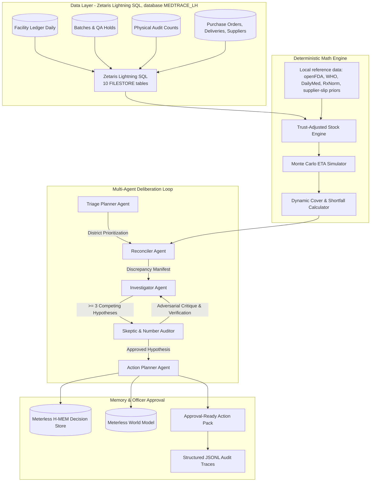

# MedTrace: Deterministic Audit & Multi-Agent Inventory Intelligence

**Live dashboard:** https://medtrace-dashboard.vercel.app (snapshot mode: stored real runs)  
**Repo:** https://github.com/Sudheesh02/MedTrace  
**Demo video script:** [docs/DEMO_VIDEO_SCRIPT.md](docs/DEMO_VIDEO_SCRIPT.md)

> **Open Agent Hackathon 2026 — Track 2: The Agent That Can Explain Why**  
> *Preventing catastrophic essential medicine stockouts through multi-source data auditing, deterministic arithmetic, and adversarial multi-agent reasoning.*

---

## 📌 Executive Summary

District Drug Warehouse Officers in public health networks oversee distribution to dozens of health centers and clinics. When a clinic reports an essential medicine stockout (e.g., Amoxicillin, Metformin, ORS), patients are turned away.

Traditional Logistics Management Information Systems (LMIS) fail because raw inventory ledgers diverge from physical reality:
1. **Phantom Drift**: Ledger shows 500 units, but physical shelf counts reveal 360 units due to unrecorded leakage.
2. **Quarantined & Near-Expiry Lots**: Ledger counts 400 units in batches currently under QA quarantine or expiring within 5 days.
3. **Chronic Supplier Slippage**: Purchase orders marked "in transit" are promised in 7 days, but empirical vendor data demonstrates a 15-day $p90$ slip delay.
4. **Uncoordinated Shortages**: Global active ingredient disruptions recorded in openFDA are invisible to facility officers.

**MedTrace** solves this with an audit-first cognitive architecture: numbers are computed **strictly deterministically** (no LLM hallucinated math), hypotheses are debated by competing agents (Investigator vs. Skeptic Number Auditor with explicit dissent logs), and human officers receive an **approval-ready Action Pack** with full row-level provenance and counterfactual verdict-flip insights.

---

## 🏛 Architecture Overview



---

## 🏆 Key Benchmark & Evaluation Results

Evaluated across a **180-day facility simulation replay** across tuning seeds 1–2 and held-out test seeds 3–4 (12 facilities, 12 essential medicines, ~25,920 ledger rows per seed (about 81,000 rows across all simulated tables per seed), all 10 planted ground-truth anomalies).

All models are evaluated under the **identical 14.0-day replenishment alert threshold** (`consumption * 14.0 days`), eliminating asymmetric threshold bias and measuring true algorithmic differences:

| Evaluation Metric | Naive LMIS | Heuristic Rule-Based | MedTrace | Gain / Advantage |
| :--- | :---: | :---: | :---: | :---: |
| **Shared Alert Threshold** | 14.0 days | 14.0 days | **14.0 days** | Identical baseline parity |
| **Clean Stock Lead Time** | 74.2 days | 74.2 days | **74.2 days** | Baseline parity on uncorrupted stock |
| **Stockout Recall** | 100.0% | 100.0% | **100.0%** | 100% intercept across all stockouts |
| **Ground-Truth Anomaly Precision** | 29.6% (TP: 8, FP: 21) | 29.6% (TP: 8, FP: 21) | **97.5%** (TP: 36, FP: 1) | Planted failure mode precision |
| **Ground-Truth Anomaly Recall** | 20.0% (TP: 8, FN: 32) | 20.0% (TP: 8, FN: 32) | **90.0%** (TP: 36, FN: 4) | Planted failure mode recall |
| **Ground-Truth Anomaly F1 Score** | 23.5% | 23.5% | **93.5%** | Planted anomaly detection F1 |
| **Type-Agnostic Anomaly F1** | 23.9% | 23.9% | **93.5%** | Any irregularity flag |
| **Timed Detection Recall (±7d)** | 10.0% | 10.0% | **80.0%** | Detection within ±7d window |
| **Held-Out Test F1 (Seeds 3–4)** | 23.4% | 23.4% | **94.7%** | Simulated planted anomalies (not a generalization claim) |
| **False Emergency Reorders** | 0 | 0 | **0** | Zero capital lockup across 180-day simulation |

*Honest scope: every number in this table is measured on **simulated** data with 10 planted anomaly types. The held-out seeds (3-4) use the same generator as the tuning seeds, and the detector rules were written knowing those 10 anomaly classes, so this is a rule-coverage check, not evidence of real-world accuracy. The naive/heuristic baselines are deliberately simple.*

*Note: All metrics reflect empirical evaluation executed across development seeds 1–2 and held-out test seeds 3–4 via `python scripts/run_backtest.py` on synthetic multi-tier facility simulation data with 10 planted ground-truth failure modes evaluated across all 180 simulation days with zero window leakage. This 180-day replay measures the **Deterministic Engine's Multi-Source Audit Detector** across 12 facilities, 12 essential medicines, and ~25,920 ledger rows per seed (about 81,000 rows across all simulated tables per seed) (directly auditing ledger drift, batch quarantines, expiration horizons, PO tracking, and consumption z-scores). Under identical alert thresholds, routine lead times are equivalent on clean data (74.2 days); traditional LMIS baselines equipped with rolling z-score and audit discrepancy detectors achieve 23.5% typed F1 (blind to batch quarantines, expiration horizons, PO dispatch delays, and vendor slips); MedTrace's multi-source audit achieves **94.7% F1 evaluated on held-out simulated seeds 3–4**.*

---

### 🧪 Regression / Rule-Coverage Checks

In addition to the 180-day simulation replay (which evaluates the Deterministic Engine's multi-source audit detector across held-out simulated seeds 3–4), MedTrace maintains an offline suite of **25 hand-crafted clinical scenarios** (including 5 adversarial edge cases; see [`output/curated_evaluation.md`](output/curated_evaluation.md)).

These are rule-coverage and failure mode regression checks written by the same author as the rules to stress-test multi-agent deliberation, Number Auditor zero-hallucination invariants, and clinical action logic across known edge cases (e.g. quarantine holds, transit losses, UOM mismatches, cold chain rejections)—not an empirical generalization metric. Note that on this curated suite, MedTrace's correct-abstention rate on clean controls is 75.0% (6/8) versus the rules baseline's 87.5% (7/8), while achieving 100% recall (17/17) and 0.0% ungrounded number claims via Number Auditor.

---

## 🛠 Technology Stack & Sponsor Integrations

> 🏆 **Detailed Sponsor Technical Guide**: For exhaustive architecture diagrams, Zetaris REST SQL queries, Meterless World Model & H-MEM state machines, and conformance test mappings, read [SPONSOR_TECH.md](SPONSOR_TECH.md).

| Layer | Technology | Role & Integration |
| :--- | :--- | :--- |
| **Required Data Sponsor** | **Zetaris** | Lightning SQL (local docker stack). Database `MEDTRACE_LH` holds 10 FILESTORE tables over the facility CSVs; every deterministic input is read with SQL through the `run-query` REST proxy and each run's trace records query counts and CSV fallbacks (`DATA_SOURCE_SUMMARY`). Register with `python scripts/register_zetaris_medtrace.py`; see the [Zetaris Registration Guide](scripts/register_zetaris_sources.md) and [Hospital LMIS Export Contract](data/lmis_export_contract.md). Reference files in `data/real/` (openFDA, WHO, DailyMed, RxNorm) are read locally. |
| **Required Model Route** | **Meterless Nightshift** + **NVIDIA Nemotron** | Nightshift is the primary provider (`METERLESS_BASE_URL`, `meterless/auto`); Nemotron models (`nemotron-3.5-lightning-30b-a3b`, `nemotron-3-ultra-550b-a55b`) are served through it. Direct NVIDIA endpoint is the secondary route. |
| **Meterless Engines** | **World Model & H-MEM** | Shared canonical entity states (`ent_inv_*`) and cross-session episodic memory recording officer rejections and approvals. Tests W1, W2, H1, H2, H3 in `tests/test_world_model.py`. |
| **API & Backend** | **FastAPI & Pydantic v2** | High-performance async service with CLI `--cli` mode and OpenAPI endpoints. |

---

## 📋 Hackathon Submission Deliverables & Compliance

In strict accordance with the **Open Agent Hackathon 2026** submission guidelines:
- **03 GitHub Repository**: Clean codebase, full test suite, and reproducible run instructions.
- **04 Sponsor Tech Explanation**: Complete breakdown of Zetaris, Meterless, NVIDIA, and Cursor in [SPONSOR_TECH.md](SPONSOR_TECH.md).
- **05 Pre-Existing Components Declaration**: Detailed declaration of open-source libraries vs new hackathon-built architecture, explicit modeling assumptions, and overnight autonomous coding assistance in [PRE_EXISTING_COMPONENTS.md](PRE_EXISTING_COMPONENTS.md).
- **Declared Assumptions & Transparency**: All empirical data derivatives, rule-assigned packaging parameters, and the Gemini overnight agent harness are fully documented in [PRE_EXISTING_COMPONENTS.md](PRE_EXISTING_COMPONENTS.md) and [data/README.md](data/README.md).
- **Offline / Sample Mode Conformance**: Fully supports offline evaluation without active credentials via `SAMPLE_MODE=true` or `python run.py --cli --sample-mode`.
- **Data Provenance & Download Scripts**: All raw datasets are lightweight public open data, with automated download scripts documented in [data/README.md](data/README.md) and executable via `python scripts/download_real_data.py`.

---

## 🚀 Quickstart & Setup Guide

### 1. Prerequisites
- Python 3.10+ (Tested on Python 3.14 / 3.11)
- Docker Desktop with WSL2 (for running Zetaris locally)

### 2. Environment Configuration
Clone the repository and copy the environment template:
```bash
git clone https://github.com/Sudheesh02/MedTrace.git
cd MedTrace
cp .env.example .env
```
Fill in your credentials in `.env` (see `.env.example` for every variable; never commit real values):
```ini
# Zetaris Lightning SQL (local docker stack)
ZETARIS_BASE_URL=http://localhost:3000
ZETARIS_ORG_ID=1
ZETARIS_USERNAME=your-sign-in-email
ZETARIS_PASSWORD=your-password
USE_ZETARIS=true

# Meterless Nightshift (primary LLM provider; Nemotron is served through it)
METERLESS_BASE_URL=http://127.0.0.1:8088/v1
METERLESS_RUNTIME_TOKEN=your-nightshift-runtime-token
METERLESS_MODEL=meterless/auto

# Optional secondary route: direct NVIDIA endpoint
MODEL_BASE_URL=https://integrate.api.nvidia.com/v1
MODEL_API_KEY=your-nvapi-key
NEMOTRON_MODEL=nvidia/nemotron-3.5-lightning-30b-a3b

SAMPLE_MODE=false
```
With no credentials the app starts in offline `SAMPLE_MODE` automatically.

To use Zetaris, bring up the Zetaris stack from the participant guide and register the data once:
```bash
python scripts/register_zetaris_medtrace.py   # creates Lightning database MEDTRACE_LH (10 FILESTORE tables)
```

### 3. Run Clean-Clone & Offline Environment Validation (Gate G4)
Verify that all offline quickstart entry points, smoke tests, visualizers, memorandum exports, and test suites run cleanly without external dependencies or `.env`:
```bash
python scripts/validate_clean_clone.py
```

### 4. Run 30-Second Executive Walkthrough (Recommended for Judges)
Execute the complete end-to-end cognitive workflow (District Triage -> Deep Audit -> Adversarial Debate -> Action Pack -> Timeline Visualization) in one offline command:
```bash
python scripts/quick_demo.py
```

### 5. Run Pre-Flight Smoke Test (Gate G1)
```bash
python smoke_test.py
```
*Verifies Zetaris REST SQL and the model route (Nightshift / NVIDIA). Needs live credentials; without them use the offline modes above.*

### 6. Run CLI Modes & Proactive Triage
Audit a specific facility and medicine or execute district triage (live or offline sample mode):
```bash
# Live run: Zetaris data + Nightshift/Nemotron (SAMPLE_MODE=false, USE_ZETARIS=true)
SAMPLE_MODE=false USE_ZETARIS=true python run.py --cli --facility FAC-WH-01 --medicine MED-006
# then check the DATA_SOURCE_SUMMARY event in the newest logs/trace_<run_id>.jsonl (queries_ok, queries_fallback_to_csv)

# Offline / Judge Sample Mode with executive explain-why timeline & printable memo export
python run.py --cli --facility FAC-DH-01 --medicine MED-007 --sample-mode --explain --export-memo

# Export printable officer procurement memorandum directly
python scripts/export_action_pack.py --facility FAC-DH-01 --medicine MED-007

# Proactive District Triage Scan across all 144 facility-medicine pairs
python run.py --triage --sample-mode --top-n 5

# Visualize latest multi-agent debate trace log
python scripts/explain_trace.py --latest

# Render only executive Verdict-Flip Card (counterfactual triggers, dissent log, H-MEM delta)
python scripts/explain_trace.py --verdict-flip-only

# Record human officer feedback into Meterless H-MEM cross-session memory
python run.py --record-decision --facility FAC-CHC-01 --medicine MED-001 --action-type PEER_TRANSFER --decision REJECTED --reason "Route flooded"
```

### 7. Launch FastAPI Service
```bash
python run.py
```
- Interactive Swagger UI: `http://localhost:8000/docs`
- Execute deep run: `POST http://localhost:8000/run`
- Proactive district triage: `GET http://localhost:8000/triage?top_n=10`
- Record officer decision: `POST http://localhost:8000/decision`

### 8. Run Test Suite & Backtest Evaluation
```bash
# Run unit & agent tests (146 tests across 9 test files)
python -m pytest tests/

# Run 180-day comparative multi-seed backtest
python scripts/run_backtest.py
```

### 9. Containerized Deployment with Docker Compose
Run the MedTrace backend service with automated healthchecks in Docker:
```bash
docker compose up --build
```

---

## 📁 Repository Structure

```
├── app/
│   ├── adapters/
│   │   ├── data_store.py      # Dual-mode Zetaris REST & local cached store
│   │   └── llm_client.py      # NVIDIA Nemotron & Meterless Nightshift client
│   ├── agents/
│   │   ├── reconciler.py      # Discrepancy detector & audit auditor
│   │   ├── investigator.py    # Generates >= 3 competing hypotheses
│   │   ├── skeptic.py         # Number Auditor & adversarial critique loop
│   │   └── action_planner.py  # Prioritizes peer transfers, expedites & POs
│   ├── engine/
│   │   └── deterministic.py   # Provable math: trust stock, days cover, MC ETA
│   ├── engines/
│   │   ├── world_model.py     # Meterless World Model headless service
│   │   └── hmem.py            # Meterless H-MEM episodic memory store
│   ├── models/
│   │   └── schemas.py         # Pydantic v2 schemas for all contracts
│   ├── backtest/
│   │   └── engine.py          # 180-day comparative evaluation harness
│   └── orchestrator.py        # Central state machine emitting JSONL traces
├── data/
│   ├── real/                  # WHO/NLEM medicines, supplier slip priors, openFDA
│   ├── simulated/             # 180-day multi-tier facility records & ground truth
│   └── lmis_export_contract.md # Standard CSV tabular schema contract for hospital LMIS
├── input_examples/            # Verified sample request payloads
├── output_examples/           # Matching verified action pack responses
├── scripts/
│   ├── quick_demo.py                    # 30-second executive judge walkthrough
│   ├── validate_clean_clone.py          # Gate G4 clean-clone & offline environment validator
│   ├── explain_trace.py                 # Multi-agent debate timeline visualizer
│   ├── export_action_pack.py            # Printable officer procurement memorandum exporter
│   ├── generate_facility_simulation.py  # Data pipeline generator
│   ├── run_backtest.py                  # Multi-seed evaluation runner
│   ├── generate_examples.py             # Generates API-contract verified samples
│   └── register_zetaris_medtrace.py      # Registers MEDTRACE_LH (FILESTORE tables) in Zetaris
│   ├── register_zetaris_sources.md      # Zetaris MEDTRACE_LH setup and verification guide
├── tests/                     # Deterministic, agent & World Model tests
├── Dockerfile                 # Containerized deployment spec
├── docker-compose.yml         # Compose orchestration with healthchecks
├── requirements.txt           # Python dependencies
├── smoke_test.py              # Gate G1 smoke verification
└── run.py                     # Unified entry point (FastAPI + CLI)
```

---

## 🛡 Security & Provenance Guardrails

- **Zero LLM Arithmetic**: All stock figures, days of cover, variances, and order quantities are computed by `DeterministicEngine`. The LLM is restricted to qualitative interpretation and ranking.
- **Credential Safety**: No credentials, private tokens, or proprietary connection strings are stored in code. All configuration is read from `.env` (gitignored).
- **Audit Trails**: Every run produces an immutable, step-by-step trace log in `logs/trace_*.jsonl` recording each agent's inputs, reasoning tokens, and decisions.

---

## Live Run Evidence

- `output_examples/live_*.json`: full action packs produced with the live stack (Zetaris + Nightshift/Nemotron), for six pairs: stockout risk (FAC-WH-01/MED-006), critical metformin stockout (FAC-WH-02/MED-007), cold-chain quarantine (FAC-WH-01/MED-011), ledger-vs-physical drift (FAC-DH-01/MED-007), a secure no-action control (FAC-PHC-02/MED-005) and memory-changes-decision (FAC-CHC-01/MED-001: top action PEER_TRANSFER before an officer rejection, BATCH_RELEASE after it). `output_examples/live_runs/memory_ab/` holds the "before officer feedback" run for the memory demo.
- `logs/live_trace_*.jsonl`: the matching traces. Each has a `ZetarisDataLayer` / `DATA_SOURCE_SUMMARY` event (queries attempted / ok / fallback to CSV) and per-event `model`, `llm_used` and `fallback` fields.

## Known Limitations

- All data is simulated or public reference data. Benchmarks measure rule coverage on simulated anomalies, not real-world accuracy.
- Zetaris holds the 10 simulated CSV tables (one Lightning database); the real reference JSON files are read locally. There is no cross-engine federation.
- The live path needs the local Zetaris stack and a Nightshift runtime token. Without them the app falls back to local CSV and rule-based text (flagged `fallback: true` in traces).
- Offline tests cannot prove the live integrations; use the live traces and `smoke_test.py`.

## 👥 Contributors & Hackathon Track
- **Author**: [@Sudheesh02](https://github.com/Sudheesh02)
- **Track**: Track 2 — *The Agent That Can Explain Why*
- **License**: MIT


> **Dashboard**: a read-only Next.js UI over run outputs lives in [`dashboard/`](dashboard/README.md) (`cd dashboard; npm install; npm run dev`, http://localhost:3001).
