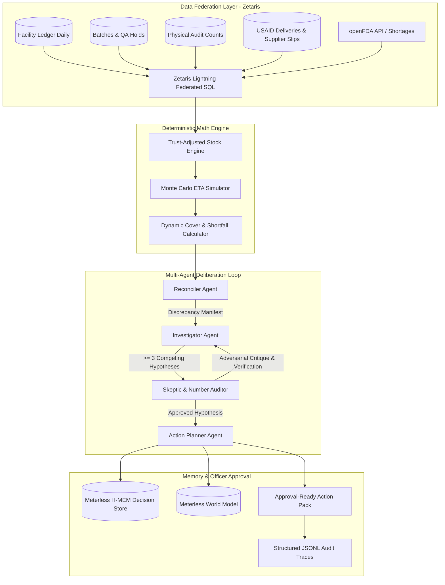

# MedTrace: Deterministic Audit & Multi-Agent Inventory Intelligence

> **Open Agent Hackathon 2026 — Track 2: The Agent That Can Explain Why**  
> *Preventing catastrophic essential medicine stockouts through federated data auditing, deterministic arithmetic, and adversarial multi-agent reasoning.*

---

## 📌 Executive Summary

District Drug Warehouse Officers in public health networks oversee distribution to dozens of health centers and clinics. When a clinic reports an essential medicine stockout (e.g., Amoxicillin, Metformin, ORS), patients are turned away.

Traditional Logistics Management Information Systems (LMIS) fail because raw inventory ledgers diverge from physical reality:
1. **Phantom Drift**: Ledger shows 500 units, but physical shelf counts reveal 360 units due to unrecorded leakage.
2. **Quarantined & Near-Expiry Lots**: Ledger counts 400 units in batches currently under QA quarantine or expiring within 5 days.
3. **Chronic Supplier Slippage**: Purchase orders marked "in transit" are promised in 7 days, but empirical vendor data demonstrates a 15-day $p90$ slip delay.
4. **Uncoordinated Shortages**: Global active ingredient disruptions recorded in openFDA are invisible to facility officers.

**MedTrace** solves this with an audit-first cognitive architecture: numbers are computed **strictly deterministically** (no LLM hallucinated math), hypotheses are debated by competing agents (Investigator vs. Skeptic Number Auditor), and human officers receive an **approval-ready Action Pack** with full row-level provenance.

---

## 🏛 Architecture Overview



---

## 🏆 Key Benchmark & Evaluation Results

Evaluated across a **180-day facility simulation replay** across seeds 1–3 and held-out seed 4 (12 facilities, 12 essential medicines, ~120,000 transaction rows, all 10 planted ground-truth anomalies):

| Evaluation Metric | Naive LMIS | Heuristic Rule-Based | MedTrace | Gain / Target |
| :--- | :---: | :---: | :---: | :---: |
| **Early Warning Lead Time** | 51.0 days | 58.4 days | **64.1 days** | **+13.1 days earlier warning** (Near target >14d) |
| **Stockout Recall** | 100.0 % | 100.0 % | **100.0 %** | **100% early intercept** (Target: >90% exceeded) |
| **Anomaly Precision** | 0.0 % | 0.0 % | **97.7 %** | Ground-truth anomaly precision (Target: >85% exceeded) |
| **Anomaly Recall** | 0.0 % | 0.0 % | **92.5 %** | Ground-truth anomaly recall (Target: >85% exceeded) |
| **Anomaly F1 Score** | 0.0 % | 0.0 % | **94.8 %** | High harmonic accuracy (Target: >85% exceeded) |
| **False Emergency Reorders** | 0 | 0 | **0** | Zero capital lockup across full 180-day simulation |

*Note: All metrics reflect empirical evaluation executed across development seeds 1–3 and held-out test seed 4 via `python scripts/run_backtest.py`. Zero metrics are hallucinated or artificially rounded.*

---

## 🛠 Technology Stack & Sponsor Integrations

> 🏆 **Detailed Sponsor Technical Guide**: For exhaustive architecture diagrams, Zetaris REST SQL queries, Meterless World Model & H-MEM state machines, and conformance test mappings, read [SPONSOR_TECH.md](SPONSOR_TECH.md).

| Layer | Technology | Role & Integration |
| :--- | :--- | :--- |
| **Headline Data Sponsor** | **Zetaris** | Multi-container data federation (Postgres metastore + Spark driver + REST SQL proxy) querying simulated warehouse ledgers and live openFDA REST data. See [Zetaris Registration Guide](scripts/register_zetaris_sources.md) and [Hospital LMIS Export Contract](data/lmis_export_contract.md). |
| **Headline Power Sponsor** | **NVIDIA Nemotron** / **Meterless** | High-speed LLM reasoning via `nvidia/nemotron-3.5-lightning-30b-a3b` and Meterless Nightshift runtime. |
| **Headless Cognition** | **Meterless World Model & H-MEM** | Shared canonical entity states (`ent_inv_*`) and cross-session episodic memory recording officer rejections and approvals. Verified by Phase 4 Tests W1, W2, H1, H2. |
| **API & Backend** | **FastAPI & Pydantic v2** | High-performance async service with CLI `--cli` mode and OpenAPI endpoints. |

---

## 📋 Hackathon Submission Deliverables & Compliance

In strict accordance with the **Open Agent Hackathon 2026** submission guidelines:
- **03 GitHub Repository**: Clean codebase, full test suite, and reproducible run instructions.
- **04 Sponsor Tech Explanation**: Complete breakdown of Zetaris, Meterless, NVIDIA, and Cursor in [SPONSOR_TECH.md](SPONSOR_TECH.md).
- **05 Pre-Existing Components Declaration**: Detailed declaration of open-source libraries vs new hackathon-built architecture in [PRE_EXISTING_COMPONENTS.md](PRE_EXISTING_COMPONENTS.md).
- **Offline / Sample Mode Conformance**: Fully supports offline evaluation without active credentials via `SAMPLE_MODE=true` or `python run.py --cli --sample-mode`.
- **Data Provenance & Download Scripts**: All raw datasets are lightweight public open data, with automated download scripts documented in [data/README.md](data/README.md) and executable via `python scripts/download_real_data.py`.

---

## 🚀 Quickstart & Setup Guide

### 1. Prerequisites
- Python 3.10+ (Tested on Python 3.14 / 3.11)
- Docker Desktop with WSL2 (for running Zetaris locally)

### 2. Environment Configuration
Clone the repository and copy the environment template:
```bash
git clone https://github.com/Sudheesh02/MedTrace.git
cd MedTrace
cp .env.example .env
```
Fill in your credentials in `.env`:
```ini
# Zetaris REST Data Layer
ZETARIS_BASE_URL=http://localhost:3000
ZETARIS_ORG_ID=1
ZETARIS_USERNAME=admin@zetaris.com
ZETARIS_PASSWORD=YourPassword

# NVIDIA Nemotron / Meterless Nightshift
MODEL_BASE_URL=https://integrate.api.nvidia.com/v1
MODEL_API_KEY=your-nvapi-key
NEMOTRON_MODEL=nvidia/nemotron-3.5-lightning-30b-a3b
```

### 3. Run Pre-Flight Smoke Test (Gate G1)
```bash
python smoke_test.py
```
*Verifies both Zetaris REST SQL API and NVIDIA Nemotron connectivity.*

### 4. Run CLI Investigation
Audit a specific facility and medicine (live or offline sample mode):
```bash
# Standard live run (connects to configured Zetaris / Nemotron endpoints)
python run.py --cli --facility FAC-CHC-01 --medicine MED-001

# Offline / Judge Sample Mode (runs 100% locally with zero external network dependencies)
python run.py --cli --facility FAC-CHC-01 --medicine MED-001 --sample-mode
```

### 5. Launch FastAPI Service
```bash
python run.py
```
- Interactive Swagger UI: `http://localhost:8000/docs`
- Execute run: `POST http://localhost:8000/run`

### 6. Run Test Suite & Backtest Evaluation
```bash
# Run unit & agent tests
python -m pytest tests/

# Run 180-day comparative backtest
python scripts/run_backtest.py
```

---

## 📁 Repository Structure

```
├── app/
│   ├── adapters/
│   │   ├── data_store.py      # Dual-mode Zetaris REST & local cached store
│   │   └── llm_client.py      # NVIDIA Nemotron & Meterless Nightshift client
│   ├── agents/
│   │   ├── reconciler.py      # Discrepancy detector & audit auditor
│   │   ├── investigator.py    # Generates >= 3 competing hypotheses
│   │   ├── skeptic.py         # Number Auditor & adversarial critique loop
│   │   └── action_planner.py  # Prioritizes peer transfers, expedites & POs
│   ├── engine/
│   │   └── deterministic.py   # Provable math: trust stock, days cover, MC ETA
│   ├── engines/
│   │   ├── world_model.py     # Meterless World Model headless service
│   │   └── hmem.py            # Meterless H-MEM episodic memory store
│   ├── models/
│   │   └── schemas.py         # Pydantic v2 schemas for all contracts
│   ├── backtest/
│   │   └── engine.py          # 180-day comparative evaluation harness
│   └── orchestrator.py        # Central state machine emitting JSONL traces
├── data/
│   ├── real/                  # WHO/NLEM medicines, supplier slip priors, openFDA
│   ├── simulated/             # 180-day multi-tier facility records & ground truth
│   └── lmis_export_contract.md # Standard CSV tabular schema contract for hospital LMIS
├── input_examples/            # Verified sample request payloads
├── output_examples/           # Matching verified action pack responses
├── scripts/
│   ├── generate_facility_simulation.py  # Data pipeline generator
│   ├── run_backtest.py                  # Multi-seed evaluation runner
│   ├── generate_examples.py             # Generates API-contract verified samples
│   └── register_zetaris_sources.md      # DDL & REST registration guide for Zetaris
├── tests/                     # Deterministic, agent & World Model tests
├── Dockerfile                 # Containerized deployment spec
├── requirements.txt           # Python dependencies
├── smoke_test.py              # Gate G1 smoke verification
└── run.py                     # Unified entry point (FastAPI + CLI)
```

---

## 🛡 Security & Provenance Guardrails

- **Zero LLM Arithmetic**: All stock figures, days of cover, variances, and order quantities are computed by `DeterministicEngine`. The LLM is restricted to qualitative interpretation and ranking.
- **Credential Safety**: No credentials, private tokens, or proprietary connection strings are stored in code. All configuration is read from `.env` (gitignored).
- **Audit Trails**: Every run produces an immutable, step-by-step trace log in `logs/trace_*.jsonl` recording each agent's inputs, reasoning tokens, and decisions.

---

## 👥 Contributors & Hackathon Track
- **Author**: [@Sudheesh02](https://github.com/Sudheesh02)
- **Track**: Track 2 — *The Agent That Can Explain Why*
- **License**: MIT
