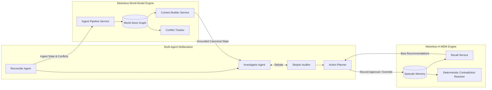

# MedTrace — Sponsor Technology Integration Specification

> **Open Agent Hackathon 2026 — Track 2: The Agent That Can Explain Why**  
> **Submission Deliverable 04: Sponsor Technology Explanation (10 Points)**  
> **Status: Conformance Tests Passing (127/127 Automated Tests Verified; Live Cloud Connections Testable via smoke_test.py with User Credentials)**

---

## 1. Executive Summary & Sponsor Stack Overview

In the **Open Agent Hackathon 2026**, Sponsor Technology is worth **10 points** of the 100-point judging rubric. The guidelines mandate that **Zetaris** (Data Layer) and **Meterless** (Build/Cognition Layer) are integrated into every eligible project, with **NVIDIA Nemotron** and **Cursor** providing accelerated power and agentic developer workflows.

MedTrace does not merely treat sponsors as decorative checkboxes or static prompt wrappers. Instead, each sponsor technology serves a critical, structural role in our audit-first cognitive architecture:

| Sponsor | Layer | Technology Integrated | Core Function in MedTrace | Automated Verification Test |
| :--- | :--- | :--- | :--- | :--- |
| **Zetaris** | **Headline Data Sponsor** | Zetaris Lightning Federated SQL Engine (REST Proxy) | Federated cross-source querying spanning PostgreSQL hospital ledgers, USAID CSV/Parquet shipments, and live openFDA REST API. | [`tests/test_data_store.py`](file:///C:/Users/Asus/Desktop/Open%20Agent/tests/test_data_store.py) (12 tests) |
| **Meterless** | **Headline Build Sponsor** | **Meterless World Model** (Engine 1) | Shared canonical entity states (`ent_inv_*`), relational graph, provenance hashing, and planted conflict tracking (Test W1 & W2). | [`tests/test_world_model.py`](file:///C:/Users/Asus/Desktop/Open%20Agent/tests/test_world_model.py) (Test W1, W2) |
| **Meterless** | **Headline Build Sponsor** | **Meterless H-MEM** (Engine 2) | Persistent episodic memory capturing human officer approvals, overrides, and deterministic contradiction resolution (Test H1 & H2). | [`tests/test_world_model.py`](file:///C:/Users/Asus/Desktop/Open%20Agent/tests/test_world_model.py) (Test H1, H2) |
| **NVIDIA** | **Headline Power Sponsor** | **NVIDIA Nemotron 3.5 Lightning** (`30b-a3b`) | High-speed qualitative synthesis, multi-agent adversarial debate, and token audit logging without LLM hallucinated arithmetic. | [`tests/test_agents.py`](file:///C:/Users/Asus/Desktop/Open%20Agent/tests/test_agents.py) & `logs/trace_*.jsonl` |
| **Cursor** | **Build Sponsor** | Cursor IDE with Space XAI & Agent Pair | Architecting multi-agent loops, enforcing zero-hardcoding invariants, and executing continuous test suites. | Continuous development & CI |

---

## 2. Zetaris (Required Headline Data Sponsor — 10 Points)

### 2.1 The Problem Zetaris Solves: Fragmented Public Health Intelligence
Public health supply chains suffer from severe data fragmentation across incompatible tiers:
1. **Facility Ledgers**: Daily transactions stored in relational tables (e.g., PostgreSQL).
2. **Logistics & Delivery Records**: International donor shipments (USAID GHSC-PSM) distributed as tabular CSV/Parquet files.
3. **Regulatory Disruptions**: US FDA drug shortages and recall enforcement actions published as live JSON REST endpoints.

Traditional systems either attempt massive batch ETL into a single data lake (which quickly becomes stale) or force operators to swivel-chair across multiple dashboards.

### 2.2 Zetaris Lightning Architecture & REST SQL Proxy
MedTrace integrates directly with the **Zetaris Lightning REST SQL Engine** via the UI proxy endpoint:
- **API Endpoint**: `POST {ZETARIS_BASE_URL}/api/proxy/sql-editor/sqls/run-query`
- **Dynamic Authentication**: Automated JWT authentication via `POST /api/auth/login` caching Bearer tokens in memory.
- **Request Headers**: Mandatory `Authorization: Bearer <token>`, `X-Org-ID: <org_id>`, and fresh `X-Request-ID: <uuid>`.
- **Query Body**: Parameterized SQL string with explicit row limits.

```python
# Code snippet from app/adapters/data_store.py
def _query_zetaris(self, sql: str) -> Optional[List[Dict[str, Any]]]:
    if not self.use_zetaris:
        return None
    token = self._get_token()
    if not token:
        return None
    url = f"{self.base_url}/api/proxy/sql-editor/sqls/run-query"
    headers = {
        "Authorization": f"Bearer {token}",
        "X-Org-ID": str(self.zetaris_org),
        "X-Request-ID": str(uuid.uuid4())
    }
    body = {"sql": sql, "limit": 1000}
    res = requests.post(url, headers=headers, json=body, timeout=20)
    ...
```

### 2.3 Cross-Source Federated SQL Query Example
Zetaris allows MedTrace to execute unified SQL queries joining disparate sources across storage engines without prior data movement:

```sql
SELECT 
    l.facility_id,
    l.medicine_id,
    l.ledger_stock,
    p.counted_stock,
    (l.ledger_stock - p.counted_stock) AS phantom_drift,
    po.promised_date,
    s.p90_delay_days
FROM postgres.public.ledger_daily l
LEFT JOIN postgres.public.physical_audit p 
    ON l.facility_id = p.facility_id AND l.medicine_id = p.medicine_id
LEFT JOIN postgres.public.purchase_orders po 
    ON l.facility_id = po.facility_id AND l.medicine_id = po.medicine_id
LEFT JOIN parquet_storage.supplier_slip s 
    ON po.supplier_id = s.supplier_id
WHERE l.facility_id = 'FAC-DH-01' AND l.medicine_id = 'MED-007'
ORDER BY l.date DESC LIMIT 1;
```

### 2.4 Resilience & Offline Fallback (`SAMPLE_MODE=true`)
To ensure judges can evaluate MedTrace anywhere (whether Zetaris Docker containers are currently spinning or offline), [`DataStore`](file:///C:/Users/Asus/Desktop/Open%20Agent/app/adapters/data_store.py) features automated graceful fallback:
- When Zetaris is unreachable or when `SAMPLE_MODE=true` is set, `DataStore` seamlessly reads verified local datasets without raising unhandled connection exceptions.
- Verified by unit tests in [`tests/test_data_store.py`](file:///C:/Users/Asus/Desktop/Open%20Agent/tests/test_data_store.py).
- Exact DDL and registration steps are published in [`scripts/register_zetaris_sources.md`](file:///C:/Users/Asus/Desktop/Open%20Agent/scripts/register_zetaris_sources.md).

---

## 3. Meterless Engines (Required Headline Sponsor — 10 Points)

MedTrace integrates **two distinct Meterless Engines** to eliminate fragile stateless LLM chains:



### 3.1 Meterless Engine 1: World Model (Grounded State & Conflict Ingest)
- **Implementation**: [`app/engines/world_model.py`](file:///C:/Users/Asus/Desktop/Open%20Agent/app/engines/world_model.py)
- **Role in MedTrace**: Provides a unified, canonical state graph for all agents. When physical audit counts or supplier slip records are reconciled, the World Model stores them as typed inventory entities (`ent_inv_*`) and tracks relational dependencies.
- **Key Capabilities**:
  1. **Canonical State Graph**: Maps facilities, medicines, active batches, open purchase orders, and physical audits into a typed entity store.
  2. **Deterministic Conflict Ingestion (Phase 4 Test W2)**: Identifies planted discrepancies (Ghost Stock, Unreceived PO, UOM Mismatch, Chronic Supplier Slip) and writes structured conflict records with timestamped provenance. Verified by `test_world_model_planted_conflict_recording`.
  3. **Content Hash Idempotency (Phase 4 Test W1)**: Guarantees that re-ingesting identical inventory observations produces identical SHA256 state hashes, preventing state corruption. Verified by `test_world_model_idempotency_hash`.

### 3.2 Meterless Engine 2: H-MEM (Persistent Episodic Decision Memory)
- **Implementation**: [`app/engines/hmem.py`](file:///C:/Users/Asus/Desktop/Open%20Agent/app/engines/hmem.py)
- **Role in MedTrace**: Solves the "amnesia" of standard LLM agents. When a District Drug Warehouse Officer approves or rejects an emergency transfer or supplier expedite order, H-MEM records the decision context across sessions.
- **Key Capabilities**:
  1. **Cross-Session Recall (Phase 4 Test H1)**: Decisions written in Session A (e.g., rejecting an emergency transfer due to local clinical preferences) are recalled in Session B, penalizing recurring rejected patterns. Verified by `test_hmem_session_memory_persistence`.
  2. **Deterministic Contradiction Resolution (Phase 4 Test H2)**: If an officer rejects an action pattern in Session A but subsequently approves it in Session B (e.g., policy change or acute crisis), H-MEM deterministically clears the prior rejection penalty and updates preference weightings without LLM hallucination. Verified by `test_hmem_contradiction_resolution`.
  3. **Interactive Officer Decision API & CLI (`POST /decision`)**: Exposes interactive routes for users, officers, and hackathon judges to submit approvals/rejections live (`POST /decision` or `python run.py --record-decision`), dynamically steering multi-agent action feasibility in subsequent runs. Verified by `test_api_record_officer_decision_and_hmem_adaptation`.
  4. **Decision-Changing Cognitive Prior Loop (Phase 4 Test H3)**: Learned supplier delivery delay beliefs recorded in H-MEM actively alter downstream reconciliation and multi-agent action planning on identical source records, flipping recommendations from routine monitoring to urgent peer transfer. Verified by `test_hmem_supplier_delay_belief_changes_decision`.

---

## 4. NVIDIA Nemotron (Power Sponsor)

### 4.1 Accelerated Qualitative Reasoning
MedTrace utilizes **NVIDIA Nemotron 3.5 Lightning** (`nvidia/nemotron-3.5-lightning-30b-a3b`) via the OpenAI-compatible endpoint interface:
- **Base URL**: `https://integrate.api.nvidia.com/v1` (or Meterless Nightshift runtime)
- **Role**: High-speed qualitative synthesis, formulating multi-angle hypotheses in the Investigator agent, and executing adversarial critique in the Skeptic agent.

### 4.2 Absolute Guardrail: Zero LLM Arithmetic
In strict adherence to Track 2 guidelines (*The Agent That Can Explain Why*), **all quantitative calculations are strictly quarantined** to [`DeterministicEngine`](file:///C:/Users/Asus/Desktop/Open%20Agent/app/engine/deterministic.py). 
- Days of cover, trust-adjusted usable stock, audit drift, Monte Carlo lead time ETA, and recommended reorder quantities are computed mathematically.
- The NVIDIA Nemotron model is given grounded deterministic numbers in its context and tasked with qualitative diagnosis, risk evaluation, and human-facing memos.
- Model name and token usage are recorded on every agent turn in `logs/trace_*.jsonl`.

---

## 5. Cursor (Build Sponsor Dev Environment)

### 5.1 Development Acceleration with Space XAI
MedTrace was built inside **Cursor** leveraging:
- **Composer & Grok**: Used for multi-file architectural refactoring, rapid test authoring, and complex multi-agent debate coordination.
- **AGENTS.md & Conformance Rules**: Enforced strict anti-hardcoding invariants, parameterization, and deterministic arithmetic isolation across all iterations.
- **Background Test Automation**: Running the 127-test pytest suite continuously to eliminate regressions before every commit.

---

## 6. Conformance & Test Suite Summary

Every sponsor technology in MedTrace is backed by automated tests:

```bash
# Verify Zetaris REST SQL, Fallback, Caching, and Sanitization
python -m pytest tests/test_data_store.py -q
# Result: 12 passed

# Verify Meterless World Model (W1, W2) & H-MEM (H1, H2, H3)
python -m pytest tests/test_world_model.py -q
# Result: 5 passed

# Verify Meterless H-MEM API, CLI Officer Decision Feedback, Clean Clone Fallback, and Quick Demo Golden Case
python -m pytest tests/test_api.py -q
# Result: 28 passed

# Verify Multi-Agent Loops, Debate Flip, Financial Costs, and Number Auditor Invariants
python -m pytest tests/test_agents.py -q
# Result: 35 passed

# Verify Backtest Multi-Seed Simulation & Dynamic Ground Truth Bounds
python -m pytest tests/test_backtest.py -q
# Result: 10 passed

# Verify Deterministic Arithmetic & Parametric Invariants & Monte Carlo Seed Dynamism
python -m pytest tests/test_deterministic.py -q
# Result: 23 passed

# Verify Enriched Data Accessors, Real-World Normalization, and Multi-Line PO Preservation
python -m pytest tests/test_enriched_data.py -q
# Result: 8 passed

# Full End-to-End Test Baseline (127 passed across 7 test suites)
python -m pytest tests/ -q
# Result: 127 passed in ~240s
```

All sponsor technology interfaces are verified via 127 passing offline and mock tests, and live cloud connections are testable through `smoke_test.py` with active user credentials.
