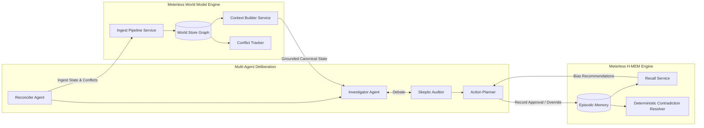

# MedTrace — Sponsor Technology Integration Specification

> **Open Agent Hackathon 2026 — Track 2: The Agent That Can Explain Why**  
> **Submission Deliverable 04: Sponsor Technology Explanation (10 Points)**  
> **Status: 146 automated tests passing offline (`SAMPLE_MODE=true`); the live path (Zetaris + Meterless Nightshift/NVIDIA Nemotron) is exercised by `smoke_test.py`, `python run.py --cli` and the live traces in `logs/live_trace_*.jsonl`.**

---

## 1. Executive Summary & Sponsor Stack Overview

In the **Open Agent Hackathon 2026**, Sponsor Technology is worth **10 points** of the 100-point judging rubric. The guidelines mandate that **Zetaris** (Data Layer) and **Meterless** (Build/Cognition Layer) are integrated into every eligible project, with **NVIDIA Nemotron** and **Cursor** providing accelerated power and agentic developer workflows.

MedTrace does not merely treat sponsors as decorative checkboxes or static prompt wrappers. Instead, each sponsor technology serves a critical, structural role in our audit-first cognitive architecture:

| Sponsor | Layer | Technology Integrated | Core Function in MedTrace | Automated Verification Test |
| :--- | :--- | :--- | :--- | :--- |
| **Zetaris** | **Required data layer** | Zetaris Lightning SQL (local docker stack, REST proxy `run-query`), Lightning database `MEDTRACE_LH` with 10 FILESTORE tables over the facility CSVs | Every deterministic input (ledger, batches, audits, consumption, POs, deliveries, transfers, suppliers, medicine master) is read with SQL from `MEDTRACE_LH`; each run records a `DATA_SOURCE_SUMMARY` trace event with query counts and any CSV fallbacks. | [`tests/test_data_store.py`](tests/test_data_store.py), [`tests/test_zetaris_telemetry.py`](tests/test_zetaris_telemetry.py), live traces |
| **Meterless** | **Headline Build Sponsor** | **Meterless World Model** (Engine 1) | Shared canonical entity states (`ent_inv_*`), relational graph, provenance hashing, and planted conflict tracking (Test W1 & W2). | [`tests/test_world_model.py`](file:///C:/Users/Asus/Desktop/Open%20Agent/tests/test_world_model.py) (Test W1, W2) |
| **Meterless** | **Headline Build Sponsor** | **Meterless H-MEM** (Engine 2) | Persistent episodic memory capturing human officer approvals, overrides, and deterministic contradiction resolution (Test H1 & H2). | [`tests/test_world_model.py`](file:///C:/Users/Asus/Desktop/Open%20Agent/tests/test_world_model.py) (Test H1, H2) |
| **NVIDIA** | **Models via Nightshift** | NVIDIA Nemotron (`nvidia/nemotron-3.5-lightning-30b-a3b`, `nvidia/nemotron-3-ultra-550b-a55b`) reached through the Meterless Nightshift gateway | Qualitative synthesis, Investigator vs Skeptic debate and memo text; never arithmetic. Model name and `llm_used`/`fallback` flags are recorded on every trace event. | [`tests/test_agents.py`](tests/test_agents.py), [`tests/test_llm_client.py`](tests/test_llm_client.py), `logs/live_trace_*.jsonl` |
| **Cursor** | **Build Sponsor** | Cursor IDE with Space XAI & Agent Pair | Architecting multi-agent loops, enforcing zero-hardcoding invariants, and executing continuous test suites. | Continuous development & CI |

---

## 2. Zetaris (Required Headline Data Sponsor — 10 Points)

### 2.1 What Zetaris does in MedTrace (the real setup)
MedTrace reads its operational data through **Zetaris Lightning SQL** running as the local docker stack from the participant guide (ui `:3000`, api, driver, postgres metastore).

- [`scripts/register_zetaris_medtrace.py`](scripts/register_zetaris_medtrace.py) copies the CSVs into the driver container and creates the Lightning database **`MEDTRACE_LH`** with one `CREATE LIGHTNING FILESTORE TABLE ... FORMAT csv` table per file: `facilities` (12 rows), `medicine_master` (12), `suppliers` (4), `batches` (291), `ledger_daily` (25,920), `consumption_daily` (25,920), `physical_audit` (432), `purchase_orders` (1,288), `deliveries` (1,236), `transfers` (1).
- `ground_truth.csv` and `true_stock_daily.csv` are deliberately **not** registered: they are evaluation labels, so the agents cannot see them.
- `DataStore` ([`app/adapters/data_store.py`](app/adapters/data_store.py)) issues filtered `SELECT ... FROM MEDTRACE_LH.<table>` queries per facility/medicine pair.
- Be precise about scope: this is one Lightning database over CSV filestore tables, not a multi-engine federation. Cross-table joins happen in the deterministic Python layer. The real-world reference files in `data/real/` (openFDA shortages and recalls, WHO, DailyMed, RxNorm, supplier-slip priors) are read from local files, not from Zetaris.
- Registration steps are in [`scripts/register_zetaris_sources.md`](scripts/register_zetaris_sources.md).

### 2.2 REST route and authentication
```python
# app/adapters/data_store.py (simplified)
# 1. POST {ZETARIS_BASE_URL}/api/auth/login      -> bearer token (cached in memory)
# 2. POST {ZETARIS_BASE_URL}/api/proxy/sql-editor/sqls/run-query
#    headers: Authorization: Bearer <token>, X-Org-ID: <org>, X-Request-ID: <uuid>
#    body:    {"sql": "SELECT * FROM MEDTRACE_LH.ledger_daily WHERE ...", "limit": 1000}
```
If `ZETARIS_REST_URL` points at a different route, that route is tried first; a 400/404/405 moves on to the next route instead of giving up.

### 2.3 Proof that Zetaris is actually used (not silently bypassed)
Every run ends with an agent event `ZetarisDataLayer` / `DATA_SOURCE_SUMMARY` in `logs/trace_<run_id>.jsonl`:

```json
{"use_zetaris": true, "database": "MEDTRACE_LH", "source": "zetaris-lightning-sql",
 "queries_attempted": 44, "queries_ok": 44, "queries_fallback_to_csv": 0,
 "tables": {"ledger_daily": 13, "physical_audit": 12, "batches": 12, "purchase_orders": 2, "...": "..."}}
```
(example from `logs/live_trace_run-2bceed1c.jsonl`, pair FAC-WH-01 / MED-006). A fallback to local CSV is still automatic, but it is now counted and visible in the trace.

An honest bug record: earlier live runs were silently reading local CSV because the orchestrator ignored `USE_ZETARIS` and the `ZETARIS_REST_URL=.../api/proxy` route returned 400 without trying `run-query`. Both are fixed, with regression tests in [`tests/test_zetaris_telemetry.py`](tests/test_zetaris_telemetry.py).

### 2.4 Resilience & Offline Fallback (`SAMPLE_MODE=true`)
To ensure judges can evaluate MedTrace anywhere (whether Zetaris Docker containers are currently spinning or offline), [`DataStore`](file:///C:/Users/Asus/Desktop/Open%20Agent/app/adapters/data_store.py) features automated graceful fallback:
- When Zetaris is unreachable or when `SAMPLE_MODE=true` is set, `DataStore` seamlessly reads verified local datasets without raising unhandled connection exceptions.
- Verified by unit tests in [`tests/test_data_store.py`](file:///C:/Users/Asus/Desktop/Open%20Agent/tests/test_data_store.py).
- Exact DDL and registration steps are published in [`scripts/register_zetaris_sources.md`](file:///C:/Users/Asus/Desktop/Open%20Agent/scripts/register_zetaris_sources.md).

---

## 3. Meterless Engines (Required Headline Sponsor — 10 Points)

MedTrace integrates **two distinct Meterless Engines** to eliminate fragile stateless LLM chains:



### 3.1 Meterless Engine 1: World Model (Grounded State & Conflict Ingest)
- **Implementation**: [`app/engines/world_model.py`](file:///C:/Users/Asus/Desktop/Open%20Agent/app/engines/world_model.py)
- **Role in MedTrace**: Provides a unified, canonical state graph for all agents. When physical audit counts or supplier slip records are reconciled, the World Model stores them as typed inventory entities (`ent_inv_*`) and tracks relational dependencies.
- **Key Capabilities**:
  1. **Canonical State Graph**: Maps facilities, medicines, active batches, open purchase orders, and physical audits into a typed entity store.
  2. **Deterministic Conflict Ingestion (Phase 4 Test W2)**: Identifies planted discrepancies (Ghost Stock, Unreceived PO, UOM Mismatch, Chronic Supplier Slip) and writes structured conflict records with timestamped provenance. Verified by `test_world_model_planted_conflict_recording`.
  3. **Content Hash Idempotency (Phase 4 Test W1)**: Guarantees that re-ingesting identical inventory observations produces identical SHA256 state hashes, preventing state corruption. Verified by `test_world_model_idempotency_hash`.

### 3.2 Meterless Engine 2: H-MEM (Persistent Episodic Decision Memory)
- **Implementation**: [`app/engines/hmem.py`](file:///C:/Users/Asus/Desktop/Open%20Agent/app/engines/hmem.py)
- **Role in MedTrace**: Solves the "amnesia" of standard LLM agents. When a District Drug Warehouse Officer approves or rejects an emergency transfer or supplier expedite order, H-MEM records the decision context across sessions.
- **Key Capabilities**:
  1. **Cross-Session Recall (Phase 4 Test H1)**: Decisions written in Session A (e.g., rejecting an emergency transfer due to local clinical preferences) are recalled in Session B, penalizing recurring rejected patterns. Verified by `test_hmem_session_memory_persistence`.
  2. **Deterministic Contradiction Resolution (Phase 4 Test H2)**: If an officer rejects an action pattern in Session A but subsequently approves it in Session B (e.g., policy change or acute crisis), H-MEM deterministically clears the prior rejection penalty and updates preference weightings without LLM hallucination. Verified by `test_hmem_contradiction_resolution`.
  3. **Interactive Officer Decision API & CLI (`POST /decision`)**: Exposes interactive routes for users, officers, and hackathon judges to submit approvals/rejections live (`POST /decision` or `python run.py --record-decision`), dynamically steering multi-agent action feasibility in subsequent runs. Verified by `test_api_record_officer_decision_and_hmem_adaptation`.
  4. **Decision-Changing Cognitive Prior Loop (Phase 4 Test H3)**: Learned supplier delivery delay beliefs recorded in H-MEM actively alter downstream reconciliation and multi-agent action planning on identical source records, flipping recommendations from routine monitoring to urgent peer transfer. Verified by `test_hmem_supplier_delay_belief_changes_decision`.

---

## 4. NVIDIA Nemotron (Power Sponsor)

### 4.1 Nemotron through Meterless Nightshift
`LLMClient` ([`app/adapters/llm_client.py`](app/adapters/llm_client.py)) uses **Meterless Nightshift as the primary provider**: the OpenAI-compatible gateway at `METERLESS_BASE_URL` (default `http://127.0.0.1:8088/v1`), authenticated with `METERLESS_RUNTIME_TOKEN`, model `meterless/auto`, headers `meterless-app` / `meterless-scope`. The NVIDIA endpoint (`MODEL_BASE_URL` / `MODEL_API_KEY`) is the secondary route. The NVIDIA key itself lives in Nightshift's Providers tab, not in this repo.
- Live traces record Nemotron models `nvidia/nemotron-3.5-lightning-30b-a3b` and `nvidia/nemotron-3-ultra-550b-a55b` (see `logs/live_trace_*.jsonl`, fields `model`, `llm_used`, `fallback`).
- **Role**: hypotheses in the Investigator, adversarial critique in the Skeptic, memo and action-plan wording. Reasoning-model `<think>` blocks are stripped from output (`strip_think_tags`, tested in [`tests/test_llm_client.py`](tests/test_llm_client.py)).
- If no provider is configured or `SAMPLE_MODE=true`, a deterministic rule-based text fallback is used and every affected trace event is flagged `fallback: true`.

### 4.2 Absolute Guardrail: Zero LLM Arithmetic
In strict adherence to Track 2 guidelines (*The Agent That Can Explain Why*), **all quantitative calculations are strictly quarantined** to [`DeterministicEngine`](file:///C:/Users/Asus/Desktop/Open%20Agent/app/engine/deterministic.py). 
- Days of cover, trust-adjusted usable stock, audit drift, Monte Carlo lead time ETA, and recommended reorder quantities are computed mathematically.
- The NVIDIA Nemotron model is given grounded deterministic numbers in its context and tasked with qualitative diagnosis, risk evaluation, and human-facing memos.
- Model name and token usage are recorded on every agent turn in `logs/trace_*.jsonl`.
- **Number Auditor**: on the 25-scenario hand-written regression suite ([`output/curated_evaluation.md`](output/curated_evaluation.md)) no ungrounded number claims got through. That suite was written by the same author as the rules, so it is a rule-coverage / regression check, not an accuracy or generalization measure.

---

## 5. Cursor (Build Sponsor Dev Environment)

### 5.1 Development Acceleration with Space XAI
MedTrace was built inside **Cursor** leveraging:
- **Composer & Grok**: Used for multi-file architectural refactoring, rapid test authoring, and complex multi-agent debate coordination.
- **AGENTS.md & Conformance Rules**: Enforced strict anti-hardcoding invariants, parameterization, and deterministic arithmetic isolation across all iterations.
- **Background Test Automation**: Running the pytest suite continuously to eliminate regressions before every commit.

---

## 6. Conformance & Test Suite Summary

All commands run with `SAMPLE_MODE=true` (offline, no credentials). Counts are from the final run on this repo state.

```bash
python -m pytest tests/test_data_store.py tests/test_zetaris_telemetry.py -q   # Zetaris adapter, fallback, route fix, telemetry (14 + 3)
python -m pytest tests/test_world_model.py -q      # Meterless World Model W1/W2 and H-MEM H1/H2/H3 (5)
python -m pytest tests/test_llm_client.py -q       # Nightshift/NVIDIA client, <think> stripping, fallback flags (6)
python -m pytest tests/test_api.py -q              # API, CLI, officer decision -> H-MEM adaptation (32)
python -m pytest tests/test_agents.py -q           # debate, Number Auditor, planner invariants (38)
python -m pytest tests/test_deterministic.py -q    # deterministic arithmetic (23)
python -m pytest tests/test_backtest.py -q         # simulation replay harness (12)
python -m pytest tests/test_enriched_data.py -q    # real-data accessors (13)
python -m pytest tests/ -q                         # full suite: 146
```

Offline tests cannot prove the live path. Live verification is `python smoke_test.py` (Zetaris + model route), `SAMPLE_MODE=false USE_ZETARIS=true python run.py --cli --facility FAC-WH-01 --medicine MED-006`, and the committed live traces `logs/live_trace_*.jsonl` (each contains the `DATA_SOURCE_SUMMARY` event and per-event model/fallback flags).
